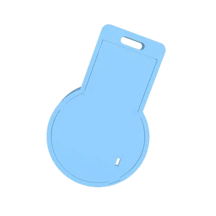

# MysteryChain

A small hobby project: a virtual pet that lives on a keychain. A round 1.28" screen, a vibration motor and a tiny battery in a 3D-printed case about 4 cm across, paired with an Android app over Bluetooth.

  

- A pixel pet on the screen: a cat, or one of a few other characters picked in the app. It gets hungry, sleepy and happy through the day.
- Shake it and the pet plays; tap the case twice to pet it. It counts your steps too.
- Messages from your phone pop up in a speech bubble, along with the time, the weather and the song that's playing.
- One button: tap for the clock, hold to turn it on or off.

**Status:** works on the breadboard. The case is test-printed; nothing is assembled in it yet.

## Building one

Parts, wiring, flashing the firmware, the app and the case are in the [developer introduction](docs/developers.md).

## License

[GPL-3.0](LICENSE)
