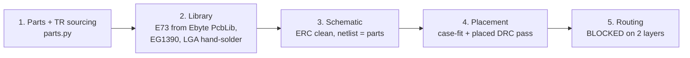

# PCB rev A: why 4 layers

| | |
| --- | --- |
| Date | 2026-10-21 |
| Status | Decided by the owner (4 layers); routing in progress |
| Spec | [2026-10-20-pcb-design.md](superpowers/specs/2026-10-20-pcb-design.md) |
| Plan | [2026-10-20-pcb-rev-a.md](superpowers/plans/2026-10-20-pcb-rev-a.md) |

**In short:** placement is finished and checked. The 2-layer board cannot be routed: under the E73 module, the front copper is a closed island, and the USB and display buses must cross inside it. A 4-layer board with a solid GND plane and vias allowed under the module brings the unrouted count down from about 30 to 8. Those 8 are local and can be fixed. The owner chose 4 layers.

## What is done (plan Tasks 1–4)

- **Parts:**
  - Every part has a Turkish source (e-komponent, direnc.net, Robiz).
  - Three parts are still marked ❓: LSM6DS3TR-C, MCP1700 and EG1390.
  - Fab: İzmir PCB import line (0.15/0.15 mm, 0.3 mm drill).
- **Library:**
  - The E73 footprint comes from Ebyte's own PcbLib, with the antenna keep-out and the under-body keep-out added.
  - Custom footprints: EG1390, wire pad rows, hand-solder LGA-14, NPTH and test pads.
- **Schematic:** generated. ERC passes, keeping only 3 explained warnings, and the netlist matches `parts.py`.
- **Placement:**
  - U1 (E73), J1 (USB-C), SW1–SW3, the J3/J4 wire pads, U3 and D1 sit on the back. Everything else is on the front.
  - The case-fit and DRC checks pass.
  - The E73 top and bottom pad rows are fanned out to via rows.
  - The case v8 inputs (SW2 +0.7 mm X, the reset hole at J1's right, and H1/H2) are listed in `electronics/pcb/README.md`.

## Why 2 layers fails

- **The island.** The back under the E73 is the module itself, so the spec bans tracks and vias there. On the front, the area under the module is closed in by the top via row, the bottom via row and the antenna keep-out. Inside it, only one layer is available.
- **The crossing.**
  - D± runs from the top pad row down to J1 at the bottom.
  - The LCD bus runs from the bottom pad row up to J2 at the top-left.
  - On one layer, these two buses cannot cross.
- **Little free space.** About 300 mm² of parts sit on about 660 mm² of usable front area, so detours have little room.

Measured with Freerouting, with GND left to the pours:

| Layers | Rule under the E73 | Unrouted (non-GND) |
| --- | --- | --- |
| 2 | no tracks, no vias (spec) | ~30 |
| 2 | vias allowed, no tracks | 24 |
| 4 (In2 = GND) | vias allowed, no B.Cu tracks | **8, all local** |

## Options we had

| Option | What it means | Verdict |
| --- | --- | --- |
| **A. 4 layers** | F signal, In1 signal, In2 solid GND, B (E73 side). Tented vias under the module. | **Chosen.** Solves the crossing. The GND plane gives the shield under the module that the spec wanted. |
| B. 2 layers, vias under the E73 | Same board with one rule relaxed. | 24 unrouted still. The crossing remains. |
| C. 2 layers, redesign | Move or rotate the E73, J1 and J2, or add 0 Ω jumpers. | Moves the case parts (USB, buttons, display pads) again. The front has no room for jumpers. |
| D. Get a TR quote first | Price 2 and 4 layers at the İzmir import line, then decide. | Does not change the routing facts. It only delays the work. |

Cost note: online 4-layer prototypes of this size cost about the same as 2-layer ones (JLC promo; not re-checked for 2026). The İzmir import price for 4 layers is **not quoted yet**. Get it before ordering.

## Next steps (Task 5 onward)

1. Switch the generators to 4 layers:
   - In the E73 body zone, allow vias and forbid B.Cu tracks; update the two checks that test this.
   - Add the In2 GND plane.
   - In route.py, keep In2 as a plane in the export to Freerouting.
2. Fix the last 8 local problems:
   - fan out J1's D±/CC/VBUS pads by hand;
   - move TP14, which sits out of reach past the antenna keep-out;
   - move JP1;
   - set J5's pin order to match the SWD vias.
3. Route until `check.py pcb` passes. Then do the fab outputs (Task 6) and the docs and bring-up phase (Task 7).
