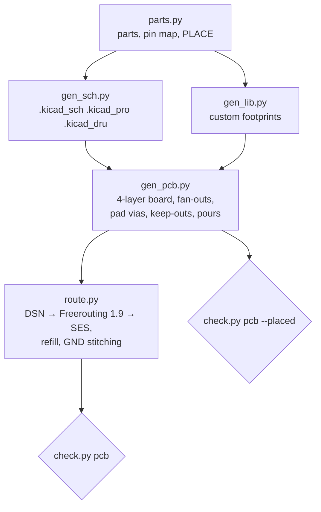
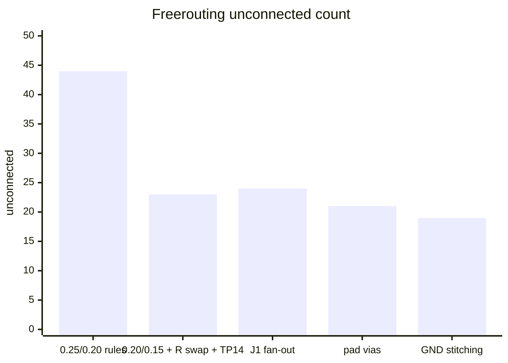

# PCB rev A — status (2026-10-21)

Branch `pcb-rev-a` work, nothing committed. Plan: `docs/superpowers/plans/2026-10-20-pcb-rev-a.md`.
Ledger: `.superpowers/sdd/2026-10-20-pcb-rev-a/progress.md`. Layer decision: `docs/2026-10-21-pcb-4-layer-decision.md`.

## Summary

- Tasks 1–4 done: schematic, footprint lib, placement, and every placed-stage check passes.
- Task 5 (routing) is in progress. The board is now **4-layer**, and `check.py pcb --placed` passes.
- The routed board is **not clean yet**. Freerouting leaves **19 unconnected** (best run) out of ~44 at the start of the 4-layer work.
- The remaining failures are **local placement traps**, not a lack of layers. Next step: move a handful of parts, then reroute.
- Tasks 6 (fab pack) and 7 (docs, bring-up) have not started.

## Task progress

## Pipeline

All board files are generated. Never edit them by hand.

## Stackup

| Layer | Use |
| --- | --- |
| F.Cu | signals + GND pour |
| In1.Cu | signals |
| In2.Cu | solid GND plane (LT_POWER), no tracks |
| B.Cu | E73 side; no tracks under the E73 body; GND pour |

- Vias are 0.3/0.6 and tented. Vias are allowed under the E73 body.
- Netclass is 0.20 track / 0.15 clearance, the fab's limit.
- The antenna keep-out covers all 4 copper layers.

## Checks

| Stage | Tests | State |
| --- | --- | --- |
| `pcb --placed` | backside_orientation, case_fit, testpoints, stackup, drc_placed | **PASS** |
| `pcb` | + drc_clean, antenna_clear, gnd_plane_under_e73, e73_back_gnd, usb_pair | **FAIL**: unconnected items |

What is left in the best routed board (scratch `st/c2`):

- **19 unconnected:**
  - 3V3 ×2
  - BATT_RAW (J3↔TP4)
  - BTN (TP11)
  - GND ×3
  - IMU_PWR
  - IMU_SCL ×3
  - MOTOR
  - NFC1 (JP1)
  - PROG (U3↔R3, 16 mm apart)
  - RESET
  - STAT
  - USB_DN (1 segment)
  - VBUS
  - XL2 (C9)
- **Violations:**
  - 6 via_dangling (cleanup pass needed)
  - 1 hole_to_hole
  - 2 known J1/SW1 NPTH artifacts. These are filtered on purpose (KiCad 9 bug, see below).

## Unconnected count history

Things that did **not** help:

- 100 passes
- continue-routing
- Freerouting 2.1, which left 30 unrouted

## Diagnosis

Most of the remaining failures are pads that greedy placement boxed in. Examples:

- U2 pad 13 (IMU_SCL) is boxed in by pads 12/14 and by C10 above them.
- R3 sits 16 mm from U3 (PROG).
- TP11 is far from SW1/U1 (BTN).
- The E73 top-row comb nets cross each other.
- The LCD bus diagonal on In1 acts as a partial wall.

Two fixes were rejected:

- **Changing the pin map.** The pin map is fixed by the spec.
- **Vias at pad ends under the module.** Solder would wick into them during hand soldering.

## Next steps

1. Fix the placement traps in `parts.PLACE`:
   - move C10/R7/R8 so U2's top pads can escape;
   - move R3 next to U3;
   - move TP11 near SW1/U1;
   - look at JP1/NFC1, RESET, MOTOR and C9/XL2.
2. Regenerate and run `check.py pcb --placed`. Then run `route.py` and `check.py pcb`. Repeat until it passes.
3. Remove dangling unlocked vias after routing.
4. Ledger the rulings that are not recorded yet:
   - J1 two-row fan-out
   - PAD_VIAS
   - GND stitching
   - VIA_VIA 0.25
   - any new placement moves
5. Close Task 5 with `task-done`, then do Task 6 (fab pack) and Task 7 (docs).

## Tooling gotchas (KiCad 9.0.9 + Freerouting)

- **Layer type vs. flips.** Calling `Flip()` while In2 is LT_POWER drops the inner layers from zones. Set the layer type *after* all flips. `test_stackup` pins this.
- **Flipped NPTH pads.** These F&B.Cu pads are saved as `*.Cu`, which gives a lib_footprint_mismatch on 4 layers. `check.py` filters only this artifact (`_npth_artifact`).
- **Principal layer.** `GetPrincipalLayer()` returns F.Cu on flipped pads. Use `IsFlipped()` instead.
- **Rules Freerouting ignores.** It ignores pad-local clearance, the copper-to-edge clearance, and hole-to-hole:
  - `gen_pcb.py` adds fiducial keep-outs;
  - `route.py` adds an edge-band rule area during DSN export only;
  - `route.py` patches the DSN with `via_via 0.25`.
- **Running Freerouting.** 1.9 needs `xvfb-run`. 2.1 needs JDK 21, ignores `-mp`, and routed worse here.
- **Thermals.** Starved thermals are fixed with a `.kicad_dru` rule, `min_resolved_spokes 1`. It is safe because every GND pad also has its own via to In2.

## Agent skills and tools for PCB work (researched 2026-10-21)

| Tool | What it is | Fit here | State |
| --- | --- | --- | --- |
| [drandyhaas/KiCadRoutingTools](https://github.com/drandyhaas/KiCadRoutingTools) | Rust-accelerated grid A* router (octilinear, multi-layer, auto vias, plane creation) for KiCad 9/10. CLI works on `.kicad_pcb`. Ships Claude skills: plan-pcb-routing, diagnose-routing-failures, review-routed-board, recommend-stackup, identify-diff-pairs, analyze-power-nets, … | **Best fit.** A second router to try against the 19 open nets, and its *diagnose-routing-failures* skill matches the current problem. | MIT, ~550★, pushed 2026-10-21. (The atomic14 fork is stale.) |
| [aklofas/kicad-happy](https://github.com/aklofas/kicad-happy) | Review skills: parses sch/pcb/gerbers into JSON; JLCPCB/BOM/LCSC/DigiKey, EMC, SPICE skills | Task 6–7: DFM/BOM review before fab | MIT, ~1.5k★, pushed 2026-10-15 |
| [oaslananka/kicad-mcp-pro](https://github.com/oaslananka/kicad-mcp-pro) | MCP server + skills: pcb-design, drc-check, fabrication-output, schematic-review | Task 6 fab outputs; overlaps with our `check.py` | MIT, ~140★, v4.3.0, pushed 2026-10-21 |
| [mixelpixx/KiCAD-MCP-Server](https://github.com/mixelpixx/KiCAD-MCP-Server) | Largest KiCad MCP (~240 tools: routing via Freerouting, DRC, Gerber, JLCPCB). Successor "Konnect" is a KiCad 10 IPC plugin (AGPL-3.0) | Low: our generator pipeline already covers this; routing still uses Freerouting | MIT, ~2.9k★, pushed 2026-10-01 |
| [Freerouting](https://github.com/freerouting/freerouting) | Current router | In use (1.9) | GPL-3.0, active |
| DeepPCB / Quilter | Commercial AI routers (RL / physics-driven), KiCad import | Possible fallback; the data is vendor benchmarks only, nothing independent | Cloud, trial access |

Recommendation: try KiCadRoutingTools on a **copy** of the placed board, alongside the placement-trap fixes. It does not replace `route.py` unless it beats 19 open.

Installed 2026-10-21:

- **Location:** `~/tools/KiCadRoutingTools` (v0.23.1).
- **Python:** a venv at `.venv`, with numpy, scipy and shapely. KiCad's system Python has no scipy.
- **Rust router:** prebuilt `grid_router.so`.
- **Skills:** symlinked into `~/.claude/skills` (all except stress-test-router).
- **Running:** the skill commands are repo-relative. Run them from that directory with `.venv/bin/python`.
