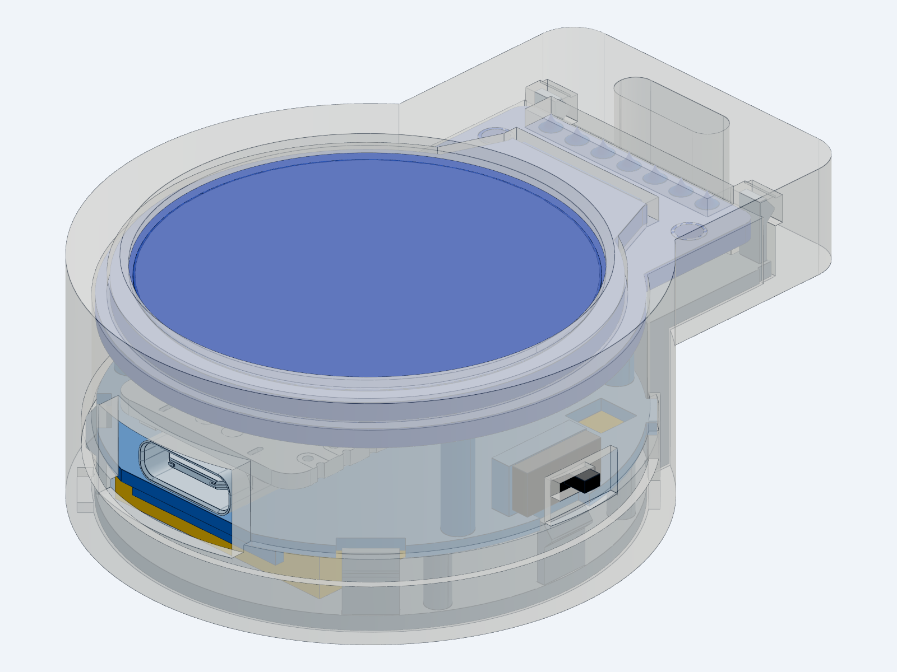

# MysteryChain: developer introduction

Where everything is and how to build one. The [README](../README.md) is the short version.

A keychain virtual pet. A 1.28" round display, BLE and a vibration motor in a 42 mm 3D-printed case. Shake it and the pet plays; messages from your phone pop up in a speech bubble.

<p align="center">
  
</p>

**Status:** working on the breadboard (four scenes, BLE messaging, clock sync, find, quick reactions, Android app). Case v7 (battery beside the XIAO in a full-depth lug, Ø42.2 × 65.8 × 13.7; thin front lip, port-shaped USB-C hole, button on/off, battery switch on the back under tape) had its first PLA test print on 2026-10-16; v7.2 (fit fixes + XIAO held by its header pins in midframe rails) waits for a reprint. Drawings are current. The LiPo isn't bought yet, so nothing is assembled in the case.

## Hardware

| Part | Role |
| --- | --- |
| Seeed XIAO nRF52840 Sense | MCU, BLE, IMU, LiPo charger |
| GC9A01 1.28" 240×240 round TFT | Display |
| 10×3 mm coin vibration motor + BC337 | Haptics |
| Tact button + AO3401A | Input and daily on/off in firmware; the MOSFET cuts the display |
| EG1390 slide switch | Battery switch, from the back under tape (storage, water, hangs) |
| LiPo 402030 (~200 mAh) | Battery |

Full parts list, pinout and power notes: [electronics/](../electronics/).

## Repository layout

```text
interfaces/
  watch/        Device firmware: one Arduino sketch; cat, Pavi and Nausicaa picked from the phone
  mobile-app/   Flutter companion app (Android), talks to the keychain over BLE
  builder/      Tkinter tool: phone/XIAO status, build and install firmware + app (python3 builder.py)
electronics/    Parts, pinout, schematic, bring-up guide and test sketches
mechanical/     Parametric case (build123d), STEP, print files, renders
docs/           Roadmap, this guide, the showcase clip
```

## Quick start

1. Set up Arduino IDE 2 with the Seeed nRF52 core and two libraries: [bring-up, phase 0](../electronics/bring-up.md#phase-0-tools-and-software).
2. Wire the parts on a breadboard: [pinout](../electronics/README.md#pinout).
3. Flash [`interfaces/watch/firmware/firmware.ino`](../interfaces/watch/firmware/firmware.ino) (scene: the `#include` line). Shake the board.
4. Run the [mobile app](../interfaces/mobile-app/) (`flutter run`) and send the pet a message.
5. Print the case from [`mechanical/print/`](../mechanical/print/) (PETG) and assemble: [mechanical](../mechanical/README.md#assembly).

## Docs

| Doc | Content |
| --- | --- |
| [interfaces/watch](../interfaces/watch/README.md) | Scenes, flashing, tunables, how to add animations |
| [interfaces/mobile-app](../interfaces/mobile-app/README.md) | App build and the BLE protocol |
| [electronics](../electronics/README.md) | Parts, pinout, motor driver, power (button on/off), power budget |
| [electronics/bring-up](../electronics/bring-up.md) | Step-by-step build and tests, troubleshooting |
| [electronics/pcb-brief](../electronics/pcb-brief.md) | Brief for whoever designs the custom PCB: requirements, parts, case fit |
| [mechanical](../mechanical/README.md) | Case design, assembly, printing; `showcase.py` renders the spinning clip in the README |
| [docs/roadmap](roadmap.md) | Planned features and open decisions |
