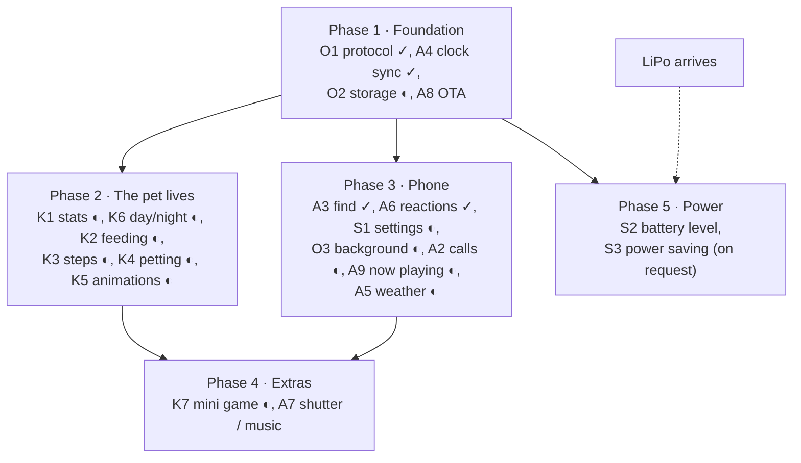

# Roadmap

Features planned for the prototype: what each does and what it depends on. How each is implemented is decided when its turn comes. New ideas get added here.

## Working today

- **Scenes:** pixel cat, Pavi, Nausicaa + Teto, Teto ([watch](../interfaces/watch/)), one firmware. Shake to play.
- **BLE messaging:** Nordic UART, device name `MysteryChain`. Phone text scrolls in a speech bubble and the motor buzzes twice; button and shake events go to the phone. Commands start with `#` (O1, [protocol](../interfaces/watch/README.md#protocol)).
- **Clock sync (A4), find (A3), quick reactions (A6):** see the tables below. Tested end to end on the bench PNP board (USB only, [T11](../electronics/bring-up.md)) with the app on 2026-10-15.
- **Pets: cat and Pavi (K1–K7, S1, O2), coded 2026-10-15 (Pavi 2026-10-16), not yet tested on hardware:** stats saved in flash, moods and new animations, day/night sky, feeding, petting, steps, runner game, settings from the app, a music screen ([pets](../interfaces/watch/README.md#pets), screens: [day/night](mockups/pet_day_night.png), [animations](mockups/pet_animations.png), [game](mockups/pet_game.png), [app](mockups/app_pet_screens.png)). Both have the same animation set; PC clips of all of them come from `interfaces/watch/test/preview.cpp`. Tap threshold and step counting still need a check through the printed case.
- **Android app:** pairs once (companion device dialog), keeps the link with the app closed, find, quick reactions, messages and an activity list, dark theme ([mobile app](../interfaces/mobile-app/), [screens](mockups/)). Tested on a Xiaomi Redmi Note 12.
- **Background link (O3), incoming call (A2), now playing (A9), coded 2026-10-16, rebuilt the same day as a foreground service, not yet tested end to end:** caller name and ring buzz, the playing track in the bubble, with the app closed. Needs Android Notification access. On Xiaomi also Autostart and Battery saver "No restrictions".

## Planned features

IDs are used for cross-references: **A** = phone ↔ keychain, **K** = pet, **S** = system, **O** = shared groundwork.

### Phone ↔ keychain

| ID | Feature | What it does | Needs |
| --- | --- | --- | --- |
| A2 | Incoming call | **Coded.** Caller name on screen, buzzes while ringing, stops when the call ends. No answer/reject. Read from the dialer's call notification, so WhatsApp calls count too. | O1, O3 |
| A3 | Find my keychain | **Done.** "Find" in the app: patterned vibration and a blinking screen until the button is pressed (or 60 s). Works during quiet hours too. | O1 |
| A4 | Clock sync | **Done.** The phone sends the time on connect; the board keeps time and corrects on each connection. A button tap shows it. | O1 |
| A5 | Weather | **Coded 2026-10-19, not yet tested on hardware.** The phone pulls the next 4 hours from open-meteo (free, no key) for its coarse location, on every connect and hourly, and sends the worst hour as one of clear / cloudy / wind / rain / snow / storm (`#weather`). The scene and the pet follow it (cat: shades in the sun, an umbrella in the rain, pawing at snowflakes; Pavi: a water dome over her, catching flakes; Nausicaa: a big leaf for an umbrella, Teto playing in the snow; all: blown leaves, startled by thunder); a button tap shows its icon next to the clock ([pets](../interfaces/watch/README.md#pets)). | O1, O3, A4, K6 |
| A6 | Quick reactions | **Done.** One-tap messages in the app (heart, "on my way", "where are you"). Bubble on the board, the pet reacts. | O1 |
| A7 | Camera shutter / music control | The button acts as a media key (BLE HID): take a photo, play/pause, next track. | O4, decision 2 |
| A8 | Over-the-air update | Flash firmware over BLE (Bluefruit `BLEDfu`) instead of USB. Must work before the case is closed; needs testing with the XIAO bootloader. | — |
| A9 | Now playing | **Coded.** When the phone's track changes, the pets switch to a music screen (character-colored backdrop, scrolling title, the pet dances); other scenes use the bubble. No buzz. Any player with a media notification. | O1, O3 |

### Pet

| ID | Feature | What it does | Needs |
| --- | --- | --- | --- |
| K1 | Hunger, happiness, energy | **Coded.** Three stats that change over time and drive behavior. Stored in flash, background only: they pick the animations, not shown in the app (2026-10-16). | O2, A4 |
| K2 | Feeding | **Coded.** The pet eats (animated), hunger drops. Double tap on the button, or Feed in the app. | K1, O4 |
| K3 | Step counter | **Coded.** Uses the IMU's hardware pedometer. Walking raises happiness and energy. Daily steps in the app, reset at midnight. | K1, A4 |
| K4 | Petting | **Coded.** Double-tap the case (IMU tap detection): hearts, purr-like buzz, happiness up. Must not clash with shake detection. | K1 |
| K5 | New animations | **Coded** for the cat and Pavi. Sleep (Zzz), eating, purring, angry, bored, yawning, dancing to music; now and then a visitor passes and the pet chases it; idle tricks (cat: grooming, tail chase; Pavi: wave, sit, twirl). Follow the [animation rules](../interfaces/watch/README.md#rules-for-new-animations). Ongoing. | K1 |
| K6 | Day/night | **Coded** for the cat and Pavi. Background follows the real clock: dawn, day with clouds, sunset, night sky with moon and stars (Pavi: aurora). The pet sleeps at night. | A4 |
| K7 | Mini game | **Coded.** Runner (Chrome dino style): tap = jump, hold = high jump, high score kept; score goes to the app. Raises happiness, costs energy. | K1, O4, decision 3 |

### System

| ID | Feature | What it does | Needs |
| --- | --- | --- | --- |
| S1 | Settings from the app | **Coded.** Vibration on/off, shake sensitivity (`SHAKE_G` today), quiet hours, pet name, the pet's look (cat or Pavi, 2026-10-16). Persisted in flash. | O1, O2, A4 |
| S2 | Battery level | Shown on the device and in the app; the pet looks tired when low. Below ~3.4 V without USB it turns itself off (code in bring-up T10, not in the scenes yet). | LiPo, K1 |
| S3 | Power saving | Display sleeps or fps drops when idle; wakes on button, shake or BLE event. | LiPo |

**Power on/off** is coded in every scene: the button does it (hold 3 s = off, ~1 s = on, USB plug-in = on). The battery switch on the back (under tape) is only for storage, water and hangs. It needs the display switch Q2 (AO3401A), now a required part; until Q2 is fitted, "off" leaves the backlight on. Not tested on hardware yet (bring-up T10).

**S3 is on hold** until the LiPo arrives. Off is not S3: off is a reset on wake, S3 keeps the pet running with the display dark.

## Shared groundwork

| ID | What | Why | Used by |
| --- | --- | --- | --- |
| O1 | Message protocol | **Done:** `#command args`, anything else goes to the bubble ([protocol](../interfaces/watch/README.md#protocol)). New commands are added there. | A2–A6, S1 |
| O2 | Persistent storage | **Coded:** settings and pet stats survive power-off (internal flash, LittleFS file `/pet`). | K1, S1 |
| O3 | App in the background | **Coded:** one foreground service (`KeychainService.kt`) holds the only BLE link, paired through CompanionDeviceManager (background start allowed, woken when the board is in range). A notification listener (`Bridge.kt`) feeds it calls and music. Sends `#time` and the weather (`Weather.kt`, A5) on every connect. | A2, A5, A9, A4 repeats |
| O4 | Sharing the one button | Gestures (cat): tap = clock, double tap = feed, hold 1–3 s = game, hold 3 s = off, any press stops find. Shutter/music (A7) still open. | K2, K7, A7, A3 |

## Suggested order

Phases 2 and 3 don't depend on each other and can run in parallel.

✓ = done, ◐ = coded, not yet tested on hardware. OTA is in phase 1 because USB updates get awkward once the case is closed.

## Open decisions

| # | Topic | Options / notes | Decide by |
| --- | --- | --- | --- |
| 1 | Sharing the button (O4) | **Decided:** gestures (tap, double tap, hold 1–3 s, hold 3 s). | Done |
| 2 | HID pairing (A7) | Shutter and media keys need bonding, which changes today's "connect from the app, no pairing" flow. Always on, or a setting? | Phase 4 |
| 3 | Mini game (K7) | **Decided:** one-button runner, tap / hold for two jump heights. | Done |
| 4 | Stats hit zero (K1) | **Decided:** the pet never dies, it just looks hungry, sad or sleepy. | Done |
| 5 | Feeding source (K2) | **Decided:** button and app. | Done |
| 6 | Weather refresh rate (A5) | **Decided:** on every connect and hourly while connected (a forecast under 30 min old is resent, not fetched again); the board drops it after 4 h. | Done |
