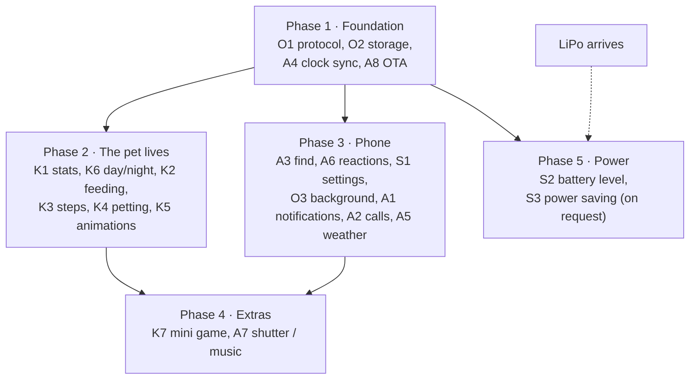

# Roadmap

Features planned for the prototype: what each does and what it depends on. How each is implemented is decided when its turn comes. New ideas get added here.

## Working today

- **Scenes:** pixel cat, Pavi, Nausicaa + Teto, Teto ([watch](../interfaces/watch/)). Shake to play.
- **BLE messaging:** Nordic UART, device name `MysteryChain`. Phone text scrolls in a speech bubble and the motor buzzes twice; button and shake events go to the phone.
- **Android app:** finds and connects, reconnects on drop, two-way messages and an event list ([mobile app](../interfaces/mobile-app/)). Tested on a Xiaomi Redmi Note 12.

## Planned features

IDs are used for cross-references: **A** = phone ↔ keychain, **K** = pet, **S** = system, **O** = shared groundwork.

### Phone ↔ keychain

| ID | Feature | What it does | Needs |
| --- | --- | --- | --- |
| A1 | Notification forwarding | Phone notifications (WhatsApp, SMS…) show app name and title in the bubble, with a vibration pattern per app. Apps are picked in the app; no vibration during quiet hours. Needs Android "Notification access". | O1, O3, S1 |
| A2 | Incoming call | Caller name on screen, buzzes while ringing, stops when the call ends. No answer/reject. | Same as A1 |
| A3 | Find my keychain | "Find" in the app: patterned vibration and a blinking screen until the button is pressed. Works during quiet hours too. | O1 |
| A4 | Clock sync | The phone sends the time on connect; the board keeps time and corrects on each connection. | O1 |
| A5 | Weather | The phone pulls local weather from open-meteo (free, no key) and periodically sends condition + temperature. Rain, snow, clouds or sun appear in the scene. | O1, O3, A4, K6 |
| A6 | Quick reactions | One-tap messages in the app (heart, "on my way", "where are you"). Bubble on the board, the pet reacts. | O1 |
| A7 | Camera shutter / music control | The button acts as a media key (BLE HID): take a photo, play/pause, next track. | O4, decision 2 |
| A8 | Over-the-air update | Flash firmware over BLE (Bluefruit `BLEDfu`) instead of USB. Must work before the case is closed; needs testing with the XIAO bootloader. | — |

### Pet

| ID | Feature | What it does | Needs |
| --- | --- | --- | --- |
| K1 | Hunger, happiness, energy | Three stats that change over time and drive behavior. Stored in flash, shown in the app. | O2, A4 |
| K2 | Feeding | The pet eats (animated), hunger drops. Triggered by the button, maybe from the app too. | K1, O4 |
| K3 | Step counter | Uses the IMU's hardware pedometer. Walking raises happiness and energy. Daily steps in the app, reset at midnight. | K1, A4 |
| K4 | Petting | Double-tap the case (IMU tap detection): hearts, purr-like buzz, happiness up. Must not clash with shake detection. | K1 |
| K5 | New animations | Sleep (Zzz), eating, purring, angry, bored, yawning; now and then a mouse or butterfly passes and the pet chases it. Follow the [animation rules](../interfaces/watch/README.md#rules-for-new-animations). Ongoing. | K1 |
| K6 | Day/night | Background follows the real clock: day, sunset, night sky with moon and stars. The pet sleeps at night. | A4 |
| K7 | Mini game | A short game on the device; score goes to the app. Raises happiness, costs energy. | K1, O4, decision 3 |

### System

| ID | Feature | What it does | Needs |
| --- | --- | --- | --- |
| S1 | Settings from the app | Vibration on/off, shake sensitivity (`SHAKE_G` today), quiet hours, pet name. Persisted in flash. | O1, O2, A4 |
| S2 | Battery level | Shown on the device and in the app; the pet looks tired when low. Below ~3.4 V without USB it turns itself off (code in bring-up T10, not in the scenes yet). | LiPo, K1 |
| S3 | Power saving | Display sleeps or fps drops when idle; wakes on button, shake or BLE event. | LiPo |

**Power on/off** is coded in every scene: the button does it (hold 3 s = off, ~1 s = on, USB plug-in = on). The battery switch on the back (under tape) is only for storage, water and hangs. It needs the display switch Q2 (AO3401A), now a required part; until Q2 is fitted, "off" leaves the backlight on. Not tested on hardware yet (bring-up T10).

**S3 is on hold** until the LiPo arrives. Off is not S3: off is a reset on wake, S3 keeps the pet running with the display dark.

## Shared groundwork

| ID | What | Why | Used by |
| --- | --- | --- | --- |
| O1 | Message protocol | Today every BLE message goes to the bubble. Clock, weather, settings, find and notifications need a message type. Plain text keeps working as now. | A1–A6, S1 |
| O2 | Persistent storage | Settings and pet stats survive power-off (flash). | K1, S1 |
| O3 | App in the background | The connection stays up and data flows while the app isn't on screen (Android foreground service). | A1, A2, A5, A4 repeats |
| O4 | Sharing the one button | Feeding, mini game, shutter/music and silencing "find" all use the same button. | K2, K7, A7, A3 |

## Suggested order

Phases 2 and 3 don't depend on each other and can run in parallel.

OTA is in phase 1 because USB updates get awkward once the case is closed.

## Open decisions

| # | Topic | Options / notes | Decide by |
| --- | --- | --- | --- |
| 1 | Sharing the button (O4) | Single / double / long press gestures, or modes? A 3 s hold is taken: power off. | Start of phase 2 (K2) |
| 2 | HID pairing (A7) | Shutter and media keys need bonding, which changes today's "connect from the app, no pairing" flow. Always on, or a setting? | Phase 4 |
| 3 | Mini game (K7) | One-button obstacle jump, tilt to catch the yarn, or something else | Phase 4 |
| 4 | Stats hit zero (K1) | Proposal: the pet never dies, it just looks sad or sleepy | Phase 2 |
| 5 | Feeding source (K2) | Button only, or the app too? | Phase 2 |
| 6 | Weather refresh rate (A5) | Battery and data vs. freshness | Phase 3 |
