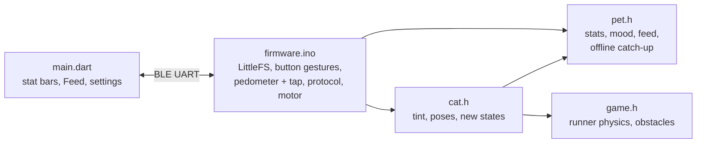

# Pet features for the cat scene: design

Date: 2026-10-15. Covers roadmap items K1–K7, S1 and O2 ([roadmap](../../roadmap.md)), for the cat scene only.

## Goal

The pixel cat becomes a pet: it gets hungry, happy or tired, sleeps at night, eats when fed, purrs when petted, counts steps and has a one-button runner game. Settings come from the app. Everything survives power-off.

**Decided with the owner**

- Cat scene only (`cat.h`). Pavi, Nausicaa and Teto stay as they are and keep compiling.
- Button shared by gesture (O4, open decision 1).
- Mini game: Chrome dino style runner. Short press = normal jump, longer press = higher jump. High score kept. A very long press leaves the game; inside the game the 3 s hold does **not** power off.
- The pet never dies (open decision 4). Feeding from the button and from the app (open decision 5).

**Out of scope:** A8 OTA, O3 background app, A1/A2/A5, S2/S3, pet features for the other scenes.

## Stats (K1)

Three values, 0–100, higher is better. Rates are tunables at the top of `pet.h`.

| Stat | Goes down | Goes up |
| --- | --- | --- |
| Fullness | 100 → 0 in 10 h awake, half that rate asleep | Feed +35 |
| Happiness | 100 → 0 in 16 h awake (no change asleep); twice as fast while fullness < 20 | Message or reaction +8 (at most once a minute), petting +5, every 100 steps +1, game up to +15 by score |
| Energy | 100 → 0 in 16 h awake, each game −10 | Sleep: 0 → 100 in 8 h |

Values are kept as floats, clamped to 0–100.

**Mood**, picked in this order, the first that holds wins:

| Mood | When |
| --- | --- |
| `sleep` | Inside the night window, or energy < 10 |
| `hungry` | Fullness < 25 |
| `sad` | Happiness < 25 |
| `tired` | Energy < 25 |
| `happy` | Otherwise |

The pet never dies. The worst it gets: hungry and sad, curled up.

**Night window (S1):** one setting, default 23:00–07:00. During it the cat sleeps and the motor stays quiet for everything except find. It is both "quiet hours" and "bedtime". Without a synced clock there is no night window.

**Feeding (K2):** fullness > 90: the cat shakes its head, nothing changes, the board answers `full`. Otherwise fullness +35, eating animation, the board answers `fed`. Feeding wakes a sleeping cat.

## Persistence (O2)

One file `/pet` on the internal LittleFS (`InternalFileSystem`, already in the Seeed core):

```c
struct Saved {
  uint8_t version;               // file layout version; a mismatch = start fresh
  float full, happy, energy;
  uint32_t steps, stepsDay;      // today's steps, and the local day number they belong to
  uint16_t best;                 // game high score
  uint32_t savedUnix;            // local time of this save in s, 0 = clock unknown
  uint8_t vib, nightFrom, nightTo;
  float shakeG;
  char name[13];
};
```

Written every 10 minutes, and right away after a feed, a settings change, a new high score, and in `powerOff()`. Missing or wrong-version file: defaults (all stats 80, settings as today, name `Kitty`).

**Time while off:** off is a reset, so time is unknown after power-on. Stats tick from `millis()` as awake. On the first `#time` after boot:

```
offline = now_unix − savedUnix − seconds since boot
```

When `savedUnix ≠ 0` and `offline > 0`, the offline time (at most 48 h) is applied with the sleep rules: energy recovers, fullness drops at the sleep rate. A save made while the clock is still unknown writes the boot file's `savedUnix` plus the uptime, so a later sync still counts every time the board was off.

## Button (O4)

| Gesture | Normal | In the game |
| --- | --- | --- |
| Tap | Clock + cheer, after a 300 ms wait for a second tap | Jump |
| Double tap | Feed | Jump |
| Hold 1–3 s, release | Start the game. A short buzz at 1 s says "release now" | Higher jump while held |
| Hold 3 s | Power off (as today) | Leave the game, no power off |
| Any press during find | Stops find, sends `found` (as today) | Same |

`button N` still goes to the phone for every tap.

## Protocol additions

Added to the [protocol](../../../interfaces/watch/README.md#protocol). Unknown `#` commands still show as text.

| Phone → keychain | Effect |
| --- | --- |
| `#feed` | Feed |
| `#stats` | Send `stats` now |
| `#set vib 0\|1` | Motor off / on (find always buzzes) |
| `#set shake <g>` | Shake threshold, clamped to 0.3–1.0 |
| `#set night <from h> <to h>` | Night window; `from == to` = no night |
| `#set name <text>` | Pet name, at most 12 ASCII characters |

| Keychain → phone | When |
| --- | --- |
| `stats <full> <happy> <energy> <steps> <mood>` | On connect (after `#time`), after a feed, when a rounded value changes (at most once a minute), on `#stats` |
| `settings vib=<0\|1> shake=<g> night=<from>-<to> name=<text>` | On connect and after every `#set` |
| `fed` / `full` | Answer to a feed (button or app) |
| `game <score> best <best>` | Game over |

The board is the source of truth for settings; the app shows what `settings` reports.

## Day and night (K6)

The scene keeps its palette indices. Only the RGB values of the sky, grass, star and moon entries change with the time of day. The cat colors never change, so the cat reads on every background.

| Local time | Look |
| --- | --- |
| 06–08 | Dawn: pink-orange horizon |
| 08–18 | Day: light blue sky, bright grass |
| 18–20 | Sunset: orange to purple |
| 20–06 | Night: today's colors |

Neighbouring keyframes blend over the hour around each boundary. Sun and moon are drawn each frame on an arc across the sky by time, no longer baked into the background. Stars only at night, fading in at dusk. Clock unknown: night look, as today.

Interface: `kitty::tint(int minuteOfDay)` updates a mutable copy of the palette; the firmware rebuilds `pal[]`/`palInv[]` once a minute.

## Animations (K5)

New states in `cat.h`, next to `IDLE / RUN / CROUCH / JUMP / LAND / BAT`. Every one follows the [animation rules](../../../interfaces/watch/README.md#rules-for-new-animations): motion uses `dt`, nothing enters the bubble band (y 11–24).

| State | Starts | Plays | Returns to | Interrupted by |
| --- | --- | --- | --- | --- |
| `SLEEP` | Mood `sleep` and the cat is idle | Curled up, eyes closed, body rises 1 px every 2 s, "z" letters float up from the head | Stays while mood is `sleep`, then `YAWN` | Shake: startle hop, then `YAWN`. Message or button: one eye opens for 2 s, keeps sleeping. Feed: wakes, `EAT` |
| `EAT` | Feed accepted | Bowl appears next to the cat, head dips, chewing, 3 s | `IDLE` | Shake |
| `REFUSE` | Feed while full | Head shakes left-right, 1 s | `IDLE` | Anything |
| `PURR` | Double tap on the case (K4) | Sits, happy eyes, small pink hearts rise; the firmware runs 5 short soft buzzes; 2 s | `IDLE` | Anything |
| `YAWN` | Tired and idle (~every 30 s), and after waking | Mouth wide, stretch, 1.5 s | `IDLE` | Anything |
| `BORED` | Mood `sad` and idle | Lies down, half-closed eyes, tail flicks | Stays while `sad` | Anything; reacts to yarn only on shake |
| `HUNGRY` | Mood `hungry` and idle | Sits by an empty bowl, now and then looks at it | Stays while `hungry` | Anything |
| `ANGRY` | Shaken while fullness < 10 | Frowning eyes, puffed fur, hops back once | `IDLE` | Anything |
| Visitor | Mood `happy`, awake, every 2–5 min | Day: a butterfly flutters by. Night: a mouse runs along the grass. The cat chases and pounces; the visitor escapes off-screen. 30 % of pounces catch it: happiness +3 | `IDLE` | Anything |

Mood also tunes today's play: `happy` plays as now, `tired` plays half as often, `sad`/`hungry` don't start yarn games on their own.

New head frames: half-closed, closed, yawn, frown. Curled and lying poses are drawn in code like the current body.

## Steps (K3)

The IMU's built-in pedometer (LSM6DS3TR-C embedded functions, step counter registers 0x4B/0x4C). The firmware reads it every few seconds and adds the difference. Today's count resets at local midnight (when the clock is known) and is saved. No counting while off: `powerOff()` cuts the IMU supply.

## Petting (K4)

Double tap on the case via the IMU tap engine (`TAP_CFG`, `TAP_THS_6D`, `INT_DUR2`, double tap enabled), read from `TAP_SRC` each loop. A tap can also cross `SHAKE_G`, so a shake is decided 300 ms late: a double tap inside that window makes it petting, not a shake. Tap threshold and timing are tunables; they need checking through the printed case.

## Runner game (K7)

| Part | Rule |
| --- | --- |
| Field | The cat runs at x = 20, the world scrolls left. Today's background and time-of-day colors, the ground scrolls. The view is drawn 8 rows lower so a high jump stays under the score bubble |
| Low obstacle (flower pot) | A short jump clears it |
| Tall obstacle (fence, two pots) | Needs a held jump |
| Bird (score ≥ 20) | Flies just above the running cat's head: stay on the ground to pass under, a jump hits it |
| Jump | Press: take-off at 65 px/s, gravity 200 px/s². Held from 0.10 s to 0.35 s after take-off: no gravity, the cat keeps rising. A 100 ms tap peaks at 10 px (pot 6 px), a 0.35 s hold at ~20 px (fence 15 px) |
| Speed | 40 px/s, a little faster every 10 points, capped at 90 px/s |
| Score | +1 per obstacle passed, shown in the bubble band: `12 HI 57` |
| Game over | The cat tumbles, `42 BEST 57`; a new best shows `NEW BEST 42` and buzzes 3 times (longer texts scroll). A press after 1 s restarts; no press for 10 s returns to the scene; a 3 s hold leaves right away |
| Stats | Each game energy −10, happiness + min(15, score / 3). Energy < 15: the cat won't play, yawns, bubble `tired` |
| Events | A message shows in the bubble over the score for its time, the game goes on. Find ends the game and starts find. Game over sends `game <score> best <best>` |

## Code layout



- `pet.h` (new): plain C++, no Arduino. Stats, mood, feed, offline catch-up.
- `game.h` (new): plain C++, included from `cat.h` inside `namespace kitty`, uses the cat's drawing.
- `cat.h`: includes `pet.h` (animations read and change the stats); `tint()`, new head frames and poses, new states, `setMood()`, `eat()`, `refuse()`, `purr()`, `yawn()`, game entry points. Ends with `#define SCENE_PET`.
- `firmware.ino`: pet code inside `#ifdef SCENE_PET`, so the other three scenes build unchanged.
- `main.dart`: pet name in the header, three thin stat bars and today's steps under it, a **Feed** button next to Find, a gear icon opening a settings screen (vibration, shake sensitivity, night window, name). Same flat dark theme.

## Testing

- **PC:** one `g++` assert check for `pet.h` and `game.h` (`interfaces/watch/test/pet_test.cpp`): decay rates and clamping, the 48 h offline cap, feed refused when full, mood order, short jump clears a low obstacle but not a tall one, held jump clears a tall one.
- **Images first:** frame dumps of the new animations, the day/night cycle and the game, plus app mockups, shown as PNG before anything is flashed.
- **Build:** all four scenes with `arduino-cli`, `flutter analyze` clean.
- **Hardware:** bench board check list at the end of each phase.

## Phases

| Phase | Items | On the board |
| --- | --- | --- |
| 1 | O2, K1, S1, K2 + app stats/settings | Stats move and survive power-off, settings from the app, feeding |
| 2 | K6, K5 | Day/night colors, sun/moon, new animations by mood |
| 3 | K3, K4 | Steps in the app, double-tap purr without false shakes |
| 4 | K7 | Runner game, high score |

## Risks

- Tap detection through the case may need threshold tuning or may fight with shakes; the 300 ms shake delay is the first fix to try.
- LittleFS shares internal flash with Bluefruit's bonding storage; both use `InternalFileSystem`, so no extra partition is needed.
- Loop time: the game and new animations run on the same ~22 fps budget; the scene already measures 21–22 fps on the bench board.
