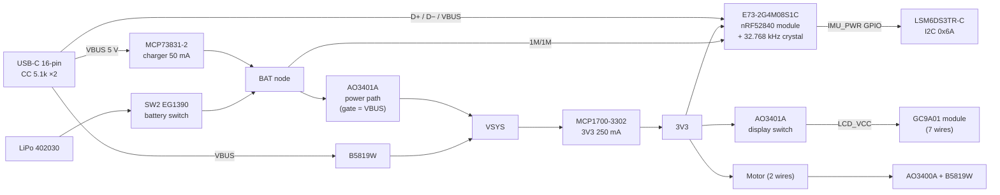

# MysteryChain PCB rev A: design

Date: 2026-10-20. Replaces the XIAO nRF52840 Sense and the free-air parts (Q2, motor driver, SW2, button wiring) with one custom PCB.

## Why

Prototype 1 is a XIAO + display module + parts soldered in free air. It works, but each unit is hours of fiddly wiring, the XIAO costs ~₺772–1258 in Turkey (often out of stock), and the build can't be repeated or tested the same way twice. One PCB makes the electronics cheaper, repeatable and testable, and is the base for a 100–1000 unit run later.

## Decided with the owner

- **Phases:** Prototype 1 = current XIAO build. **Prototype 2 = this PCB, 1–10 units, hand-soldered by the owner.** Series production of 100–1000 later.
- **Display stays the 7-pin GC9A01 module** for now (a bare panel is hard to buy cheaply in Turkey). A bare panel on an FPC connector is a later revision.
- **Source in Turkey first.** Customs is the main cost concern (the €30 duty-free limit is gone since Feb 2026). Parts from abroad only where no local source exists.
- **Part choice is delegated** to the builder ("pick the best parts, we change them if needed").
- Cost as low as possible, and the board must be fully testable.

## Goals

1. All current features keep working, with the same firmware behaviour: display, BLE (NUS), IMU pedometer + tap (LSM6DS3TR-C hardware functions), motor, one button with on/off, battery %, charge status, System OFF.
2. **Off current ≤ 10 µA** (battery switch on, System OFF).
3. **Hand-solderable** with an iron, flux and a hot-air gun or hotplate. Only the IMU needs hot air.
4. **Testable:** every rail and signal on a test pad, SWD pads, staged bring-up, a self-test sketch that prints PASS/FAIL.
5. Fits case v7.2 with **small** case changes (case v8): same body, same lug, same battery bay, same USB-C position.
6. Parts available in Turkey. Each one has a TR source or a named alternative.
7. Ready for series production: standard packages, fiducials on both sides, test pads a pogo jig can reach.

## Non-goals

- Bare display panel / FPC connector (next revision).
- Microphone, QSPI flash, NFC, LED. The firmware uses none of them (the off routine only switches the mic and flash off).
- OTA (roadmap A8): no hardware needed. The USB bootloader stays.
- Waterproofing changes beyond what case v7 has.

## Anti-goals (fail even if it works)

- Needs a reflow oven to build a prototype.
- Needs parts that are only available through customs.
- USB-C plug force carried by solder joints.
- A firmware port that rewrites scene code. The port is a new board variant plus small `#ifdef`s.

## Architecture

**Power path (Adafruit Feather style):** USB present: VSYS = VBUS − diode, the P-FET is off, and the charger sees only the battery. It terminates and reports "done" correctly, which the XIAO couldn't do with the load on the battery. USB absent: the P-FET is on and VSYS ≈ battery. P-FET source = VSYS, drain = BAT, gate = VBUS with 100 k to GND. The body diode must point BAT → VSYS.

## Parts

| Ref | Part | Package | Why | TR source |
| --- | --- | --- | --- | --- |
| U1 | **Ebyte E73-2G4M08S1C** (exactly S1C; S1E lacks P1.11) | 13×18×3.0 castellated | Same nRF52840 as the XIAO, so the firmware and SoftDevice carry over. Ceramic antenna, FCC/CE. REG1 DC-DC inductors are **inside** the module. | ✅ Robiz ₺265.50 |
| Y1 | 32.768 kHz crystal, CL 9 pF, + 2× 12 pF | 3215 | The module has **no** LF crystal (manual §2.2). The firmware falls back to LFRC if Y1 is not fitted. | ❓ |
| U2 | **LSM6DS3TR-C** | LGA-14 2.5×3 | The firmware uses its hardware pedometer and tap detection. The RevA concept's LIS2DW12 has no pedometer. | ❓ bare chip not found yet |
| U3 | **MCP73831T-2ACI/OT** | SOT-23-5 | Charger. PROG 20 k = 50 mA (0.25C for 200 mAh). | ❓ |
| U4 | **MCP1700T-3302E/TT** | SOT-23 | 3V3 LDO, 250 mA, 1.6 µA Iq | ❓ |
| Q1, Q2 | **AO3401A** | SOT-23 | Power path, display switch | ❓ |
| Q3 | **AO3400A** | SOT-23 | Motor low-side switch | ❓ |
| D1, D2 | **B5819W** | SOD-123 | VBUS → VSYS, motor flyback | ❓ |
| J1 | USB-C 16-pin top-mount (TYPE-C-31-M-12 class) | SMD + THT shell legs | Same height class as the XIAO's USB-C. Shell legs take the plug force into the board; the case takes it from the board. | ❓ |
| SW1 | Side-push tact switch, 3×6 class | SMD | User button at the −X wall | ❓ |
| SW2 | **EG1390** top-actuated slide switch | SMD | Battery switch. Same part and slot as case v7. | ✅ owner has 1 (LilyPad switch board); more ❓ |
| SW3 | Small top-actuated tact switch, ~3×4 | SMD | Reset / bootloader double-press, through the midframe reset hole | ❓ |
| R, C | 0603 | | Hand-solderable. 100 µF bulk is 1206 ceramic. | ✅ common |

Only the E73 price is verified. The rest are common parts; their TR availability and prices get checked before ordering (direnc.net, Özdisan, e-komponent, Robiz, komponentci). A part with no TR source gets a pin-compatible alternative in the BOM, not a customs order.

## Pin map

Only **castellated** E73 pads are used, so the module can be soldered with an iron. The inner pads (12–24 even, 28–42 even) are under the module. Their footprint pads stay, unconnected, for later reflow. Display, button and motor keep their XIAO GPIOs where the E73 exposes them.

| E73 pad | nRF52840 | Net | Note |
| --- | --- | --- | --- |
| 7 | P0.02 | BTN | Same as XIAO D0. System OFF wake. To GND, internal pull-up. |
| 3 | P0.03 | LCD_CS | Same as XIAO D1 |
| 4 | P0.28 | LCD_DC | Same as XIAO D2 |
| 8 | P0.29 | LCD_RST | Same as XIAO D3 |
| 6 | P1.13 | LCD_SCK | Same as XIAO D8, 32 MHz |
| 10 | P0.30 | LCD_MOSI | New (XIAO used P1.15, not exposed on the E73) |
| 2 | P1.10 | LCD_EN | Q2 gate, 100 k to 3V3, **LOW = on** (as now) |
| 1 | P1.11 | MOTOR | Same as XIAO D6. Q3 gate, 100 k to GND. |
| 9 | P0.31 / AIN7 | VBAT_ADC | Same as the XIAO's. 1 M / 1 M from BAT, 100 nF at the pin, always on (~2 µA), no enable pin. |
| 15 | P0.05 | IMU_SCL | Pull-up 4.7 k to IMU_PWR |
| 17 | P1.09 | IMU_SDA | Pull-up 4.7 k to IMU_PWR |
| 33 | P0.13 | IMU_PWR | Powers the IMU (VDD + VDDIO + pull-ups) from the GPIO, high drive, like the XIAO's P1.08. 0 µA when off, and the pull-ups can't back-power it. |
| 35 | P0.24 | CHG_STAT | MCP73831 STAT through 10 k / 15 k divider (STAT drives VBUS-high when done). LOW = charging, HIGH = done; no USB reads LOW, so the firmware uses the USB-present flag (USBREGSTATUS). |
| 41 | P0.09 / NFC1 | IMU_INT1 | Through a solder jumper, **open** by default. Closing it needs `CONFIG_NFCT_PINS_AS_GPIOS`. For wake-on-motion later. |
| 43 | P0.10 / NFC2 | — | Test pad only |
| 11, 13 | P0.00, P0.01 | XL1, XL2 | Y1 |
| 26 | P0.18 | RESET | SW3 to GND + SWD pad |
| 37, 39 | | SWDIO, SWCLK | SWD pads |
| 27, 29, 31 | | VBUS, D−, D+ | Straight from J1, 4.7 µF on VBUS |
| 19, 23 | | VDD, VDDH = 3V3 | Tied together: normal-voltage mode. 4.7 µF + 100 nF. |
| 25 | | DCCH | Not connected (REG0 unused) |
| 5, 21 | | GND | |

IMU: SA0 to GND (address 0x6A, as the firmware expects), CS to VDDIO (I2C mode), 100 nF on VDD and VDDIO.

**IMU orientation:** U2 sits on the front side, so its Z axis points the opposite way to the XIAO's, and the firmware's tilt constants (`TILT_AXIS`, `TILT_SIGN`, `TILT2_SIGN`) can't be matched by board rotation alone. The PCB places U2 axis-aligned (0/90/180/270°) and records the rotation in the README. The firmware maps the axes once, in the variant, from a gravity reading on the device.

## Board

- **4 layers, 1.0 mm FR-4, parts on both sides** (owner decision 2026-10-21; was 2 layers). Stackup: F.Cu signals, In1.Cu signals, In2.Cu solid GND plane, B.Cu (module side). 2 layers did not route: with no copper under the module on the back, the front under the module is a one-layer island where the USB pair (top pads → J1) and the display bus (bottom pads → J2) must cross; Freerouting left ~30 connections open, 4 layers with vias under the module left 8, all local. JLCPCB lists 4-layer 50×50 mm × 5 at the same promo price as 2-layer (not verified for 2026); TR broker quote pending.
- One side can't hold the parts: the footprint courtyards add up to 712 mm² and the board is 754 mm² (measured from the KiCad libraries, amended 2026-10-20).
  - **Back** (facing the midframe): E73, J1, SW1, SW2, SW3, the 100 µF 1206, D1, D2. XIAO stack: 1.0 + 3.0 module + 0.3 = 4.3 mm ≤ 4.51 layer.
  - **Front** (facing the display): everything ≤ 1.2 mm high (0603, SOT-23/-5, LGA-14, crystal), plus the test and wire pads. The display PCB is 3.25 mm away and its tallest rear part (LDO) is ≤ 1.45 mm, so ≥ 0.6 mm stays clear even where they overlap.
  - 1.6 mm boards add 0.6 mm to the case if a TR fab won't do 1.0 mm.
- **Outline:** the round body below the battery bay. A circle segment **r = 18.0**, top edge at y = +7.0 (battery zone starts at 7.1), plus a tongue for J1 (about x ±5.6, J1's courtyard is ±5.37) out to its board-edge line. The cover's hook arms sit at r 18.25–18.95 and reach into the board's depth, so r 18.0 clears them without notches. Ø3.0 notches for the midframe display clamp legs (r = 17.6, 205° / 335°).
- **Case coordinates** (`pet_case.step.py`): origin at the display center, +Y toward the lug, −Y toward the USB-C, −X button. Kept from v7.2:
  - USB-C face at y = −18.2, x = 0.
  - SW2 at x −13 … −9.5, y −10.5 … −3.5, actuator through the existing midframe and cover slot.
  - SW3 as close to the old reset hole (x −5.7, y −14.8) as J1's courtyard allows; case v8 moves the hole to SW3.
  - SW1 plunger toward the −X wall hole (y ±3). SW1 is ≤ 3.2 mm tall above the board; case v8 moves the hole to its plunger height.
  - SW2 sits on the PCB 2.0 mm above the deck now, so its actuator ends at the deck front; case v8 deepens or extends the slot.
- **E73:** long axis along X, **antenna end at the +X edge**, away from the battery (+Y), the USB shell (−Y) and the motor (lug). No copper on any layer under the antenna and 2 mm around it; the antenna may overhang the edge. Under the module body: no B.Cu traces (B.Cu there is GND pour), inner pads isolated; tented vias may pass. The In2.Cu GND plane runs under the whole module, so traces on F.Cu/In1.Cu under it are shielded from it (manual §5.1 asks for no traces under the module; the GND plane between is this design's answer, amended 2026-10-21).
- **Wire pads** on the front side near the +Y edge, labelled, ≥ 2.0 mm pitch: display 7 (pad order matched to the module tab), battery 2, motor 2.
- **Test pads** (Ø1.0, front side, so a pogo jig and probes reach them with the tall back-side parts down; the jig plate clears the ≤ 1.2 mm front parts):
  - Rails: VBUS, VSYS, BAT, 3V3, LCD_VCC, IMU_PWR, GND ×2.
  - Signals: CHG_STAT, MOTOR_SW (Q3 drain), BTN, IMU_SDA/SCL.
  - SWD: SWDIO, SWCLK, RESET, 3V3, GND as a 5-pad row at 2.54 mm, for a header held in place or a pogo clip.
  - **Both sides of SW2**, so off current is measured with SW2 open and the meter across it, with no extra part.
- 2 fiducials, part refs on silkscreen, board name and revision.
- **Fixing:** the board sits on midframe standoffs and is clamped by the front housing. USB force goes housing → board edge, not into joints. The case v8 builder picks the exact standoff and ledge design.

## Case v8 (minimal)

Remove the XIAO pin rails, its tape pad and stop rib. Add a seat for the PCB outline plus standoffs and a front ledge. Move or notch the clamp legs. Body, lug, battery bay, display seat, USB pocket, button hole, SW2 slot and reset hole keep their positions. The PCB 3D model goes into `pet_case.step.py` in place of the XIAO STEP, and the interference check must pass.

## Firmware

- **Board package:** a local Arduino board definition (`hardware/mysterychain/nrf52/`) that reuses the installed Seeeduino nRF52 core 1.1.13 with its own `variant.h/.cpp`. No core fork.
  - `USE_LFXO`; `USE_LFRC` if Y1 isn't fitted.
  - No QSPI flash: `flashSleep()` sits behind `#ifdef PIN_QSPI_CS`.
  - `PIN_VBAT` = P0.31 with no `VBAT_ENABLE`.
  - The IMU on `Wire` (`PIN_WIRE_SDA/SCL`).
  - `PIN_LSM6DS3TR_C_POWER` = P0.13. The library's hard-coded P1.08 high-drive write is harmless on this board; the firmware sets high drive on P0.13 itself.
  - `PIN_CHARGING_STATUS` = P0.24.
- **Bootloader:** Adafruit nRF52 bootloader built for this board: no LEDs, double-reset entry, SoftDevice S140 matching core 1.1.13. Flashed once over SWD.
  - **Probe:** Raspberry Pi Pico running debugprobe firmware (~₺150–250 in TR), or an ST-Link V2 clone with OpenOCD.
  - After that, uploads go over USB as on the XIAO.
- **firmware.ino:** board-specific bits behind `#ifdef`:
  - VBAT enable;
  - charge current pin (gone, fixed 50 mA);
  - QSPI sleep;
  - Wire1 vs Wire.
  
  Scenes untouched.
- **Self-test sketch** (`electronics/tests/pcb_selftest/`): prints PASS/FAIL over USB serial and on screen:
  1. 3V3 / VBAT via ADC in range.
  2. IMU WHO_AM_I = 0x6A, pedometer enable readback.
  3. Display: colour bars, then off/on with LCD_EN.
  4. Motor: 200 ms pulse, operator confirms.
  5. Button: press within 10 s.
  6. CHG_STAT and USB-present.
  7. LFXO started (or LFRC reported).
  8. BLE advertising as `MC-TEST`.
  9. System OFF entered; wake with the button.

## Test plan

**Bring-up, per board, in order. Stop at the first failure.**

1. **Bare board:** no short 3V3–GND, VBUS–GND, BAT–GND (meter).
2. **Power section only** (J1, U3, U4, Q1, D1, passives): USB in → VBUS 5.0, VSYS ~4.7, 3V3 3.30. Bench supply on BAT (3.7 V, 50 mA limit, USB out) → 3V3 present, Q1 on.
3. **+ U1, Y1, SW3:** flash the bootloader over SWD, USB enumerates, the UF2 drive appears, a blink-to-serial sketch runs.
4. **+ U2 (hot air):** self-test step 2.
5. **+ Q2 and display wires:** step 3. **+ Q3, D2, motor:** step 4. **+ SW1, SW2, battery:** steps 5–6.
6. **Full self-test:** all PASS.
7. **Currents:** SW2 open, meter across the SW2 pads.

   | State | Target |
   | --- | --- |
   | System OFF | ≤ 10 µA |
   | Display on, idle | ~20–30 mA |
   | Motor start | no brownout (3V3 ≥ 3.0 V on the scope or meter min-hold) |

8. **Charge:** 50 mA, CHG_STAT goes LOW → HIGH at termination (USB in, device off).
9. **In the case:** fit, USB plug in/out 20×, BLE range ≥ 10 m with the case closed, compared with the XIAO build.

**Series (later):** the same front test pads on a pogo jig plus the same self-test sketch. The bootloader is flashed over the SWD pads in the same fixture.

## Deliverables

All under `electronics/pcb/` unless noted.

- KiCad 9 project: schematic, PCB, 3D STEP. ERC and DRC clean, DRC run with the chosen fab's rules.
- Fab pack:
  - Gerbers + drill;
  - BOM CSV with a TR source column and alternates;
  - pick-and-place;
  - assembly drawing PDF.
- 1:1 printable footprint check sheet (E73, USB-C, IMU) to lay the real parts on before ordering.
- Board definition + bootloader hex (`electronics/pcb/firmware/`), the self-test sketch, firmware `#ifdef`s.
- Case v8 in `mechanical/` with the PCB STEP.
- `electronics/README.md` + bring-up doc updated for the PCB.

## Risks

| Risk | Mitigation |
| --- | --- |
| E73 footprint wrong | Built from the manual's drawing (1.27 pitch, castellated 0.65×1.0). 1:1 paper print with the module laid on it before ordering. |
| Antenna detuned (case, battery, hand) | +X edge, full keep-out, range test vs XIAO. Rev B can move it. |
| LGA-14 IMU hand soldering | Footprint pads extended 0.25 mm outward. Hot air + flux, or a hotplate. Self-test step 2 right after. |
| Motor start browns out 3V3 (slow low-Iq LDO) | 100 µF + 100 nF at the motor, measured in bring-up step 7. Fallback (rev B): motor from VSYS with PWM. |
| Crystal doesn't start (load caps) | Firmware LFRC fallback, test pad near Y1. |
| TR part not found | Alternate in the BOM. The footprint stays where pin-compatible: MCP1700 ↔ XC6206 (check pinout), AO3401A ↔ Si2301, AO3400A ↔ Si2302. |
| A front part hits the display's rear parts or wires | Front parts ≤ 1.2 mm (checked per footprint in the build); owner checks the display rear against the 1:1 print before ordering. |
| Rev A mistakes | Test pads on every net, 0603 parts (easy to rework), solder jumper on INT1. A cut-and-bodge is fine on a prototype. |

## Left to the builder

- Exact part numbers for Y1, SW1, SW3, J1 within the classes above, picked by TR availability. Check every pinout against its datasheet, and that the MCP1700 is stable with the 100 µF on 3V3.
- Placement and routing inside the constraints above. Pad order of the display wires.
- Fab choice (TR) and its DRC rules; panelisation for series.
- Case v8 standoff and ledge design.
- KiCad tooling: install KiCad 9 (needs `sudo` on this machine, done by the owner) and script or draw as convenient, plus Freerouting if useful.
