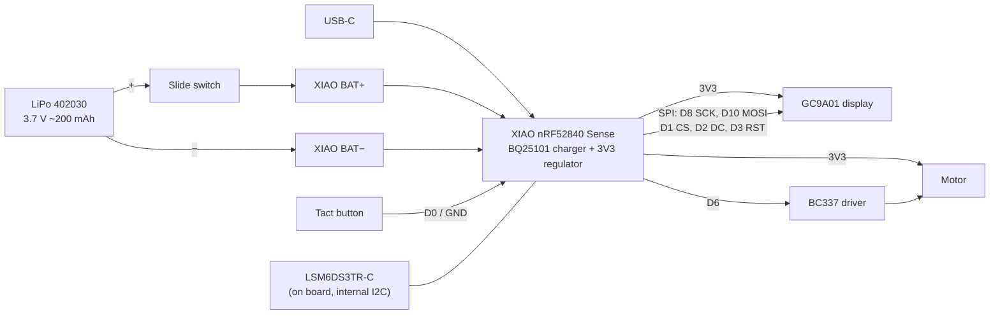

# Electronics

XIAO nRF52840 Sense + GC9A01 round display + coin vibration motor, powered by a small LiPo through a slide switch. No custom PCB: parts are wired point-to-point and soldered in free air inside the case.


- Schematic variants in [`schematic/`](schematic/): with the optional display switch Q2 (`schematic*.svg/png`) and without it (`schematic_no_q2_white.*`).
- Step-by-step build and tests: [bring-up.md](bring-up.md). Test sketches: [`tests/`](tests/).



## Parts

**Have**

| Part | Qty | Role |
| --- | --- | --- |
| Seeed Studio XIAO nRF52840 **Sense** | 1 | MCU, BLE, IMU (LSM6DS3TR-C), mic, LiPo charger (BQ25101) |
| GC9A01 1.28" 240×240 round TFT module (7-pin) | 1 | The pet's face |
| Shaftless vibration motor 10×3 (wired) | 1 | Haptic feedback |
| BC337 (TO-92) | 1 | Motor switch |
| LilyPad slide switch | 1 | Main power. The switch is desoldered from the LilyPad board and used bare. |

**Still needed**

| Part | Value | Note |
| --- | --- | --- |
| LiPo | **402030**, 3.7 V, ~200 mAh, **protected (PCM)**, with leads | Bay is 21 × 31 × 4.5: length incl. PCM **≤ 31**, thickness **≤ 4.3**. Cut off any JST plug; the XIAO has pads, no connector. |
| Tact button | 3×6 mm, **4.3 mm total height**, 2 legs | Case is drawn for exactly this size |
| Diode | **1N4148** or B5819W (SOD-123 Schottky) | Motor flyback. 1N5819 works but the DO-41 body is too big. |
| Resistor | **1 kΩ** | BC337 base |
| Resistor | 10 kΩ | Base pull-down, keeps the motor off at boot |
| Capacitor | 100 nF ceramic | 3V3 bypass |
| Capacitor | 100 µF, **≤ 4 mm tall** (1206/1210 ceramic 6.3 V or B-case tantalum) | Holds 3V3 up at motor start. A can electrolytic won't fit. |
| Thin wire | 30 AWG silicone or Kynar wire-wrap, ~1 m | Must pass the 3 mm gap between display and XIAO |
| Heat-shrink | 1–2 mm | For the free-air soldered R, D, Q |
| Double-sided tape | **0.5 mm** foam | XIAO to midframe pad |
| Kapton tape | | Insulates the display back from the XIAO pads; protects the battery |
| Key ring | wire ≤ 2.5 mm | Slot is 3 × 10 mm |
| Filament | **PETG** | 0.7 mm hook arms; PLA may snap |

**Optional:** AO3401A or Si2301 P-MOSFET (SOT-23) + 100 kΩ to switch the display backlight off (see [Power](#power)); Ø33 screen protector film (the window has no lens).

## Pinout

| XIAO pin | nRF52840 | Use | Note |
| --- | --- | --- | --- |
| D0 | P0.02 | Button | Other leg to GND. `INPUT_PULLUP` + debounce. |
| D1 | P0.03 | Display CS | |
| D2 | P0.28 | Display DC | |
| D3 | P0.29 | Display RST | |
| D4 / D5 | P0.04 / P0.05 | **Free** | External I2C. The IMU is not on this bus. |
| D6 | P1.11 | Motor | Through 1 kΩ to the BC337 base |
| D7 | P1.12 | Free | Reserved for the optional display switch |
| D8 | P1.13 | Display SCK | Labeled "SCL" on the module |
| D9 | P1.14 | Don't use | Claimed as SPI MISO |
| D10 | P1.15 | Display MOSI | Labeled "SDA" on the module |
| 3V3 | | Display VCC, motor + | |
| GND | | Common ground | |
| BAT+ / BAT− (underside pads) | | LiPo | BAT+ through the power switch |

Pins used on the board itself (Seeed Arduino variant):

| Pin | Use |
| --- | --- |
| P0.31 | Battery voltage ADC (`PIN_VBAT`) |
| P0.14 | Enables battery sensing (`VBAT_ENABLE`), **LOW = on** |
| P0.13 | Charge current: input (high-Z) = ~50 mA, output LOW = ~100 mA |
| P0.17 | Charge status: LOW = charging |
| P1.08 | IMU power switch |
| P0.11 | IMU INT1 (usable for wake-on-motion) |

**Display:** VCC → 3V3, GND → GND, SCL → D8, SDA → D10, DC → D2, CS → D1, RST → D3.

- 7-pin module with **no BL (backlight) pin**: the backlight is on whenever VCC is present.
- The module has its own 3.3 V LDO; feeding it from 3V3 is fine.
- Pin order varies by vendor. Check the labels on your board before soldering.

## Motor driver

D6 → 1 kΩ → BC337 base, 10 kΩ base to GND. Motor between 3V3 and the collector, emitter to GND. Diode across the motor with the **band (cathode) to 3V3**. 100 nF + 100 µF from 3V3 to GND, close to the motor.

- **BC337 legs:** flat face toward you, legs down: **C – B – E** (onsemi). Check your part with a diode test.
- **Why 1 kΩ:** 220 Ω would pull ~12 mA from the pin; the nRF52840 standard drive is ~2 mA (~10 mA in high-drive). 1 kΩ gives ~2.5 mA base current, and BC337-25 (hFE ≥ 160) still carries the 120 mA start current.
- **Motor:** 2.5–3.5 V, ~60 mA running at 3 V, up to 120 mA at start.
- **Firmware:** drive short pulses (100–300 ms). Ignore IMU shake detection for 200–500 ms after the motor stops; its vibration looks like a shake.

## Power

- **Wiring:** battery + → switch → XIAO BAT+; battery − → XIAO BAT−.
- **Switch OFF:** battery fully disconnected, no drain, **and no charging**. Turn the switch ON to charge. With USB plugged in, the board runs from USB either way.
- **Charging:** BQ25101 charges at ~50 mA by default (0.25C for 200 mAh, safe). Only enable 100 mA if the battery's datasheet allows 0.5C. Keep the motor off while charging during first tests.
- **Battery voltage:** drive P0.14 LOW, then read P0.31 (1 MΩ / 510 kΩ divider).

> **Never drive P0.14 HIGH.** P0.31 then sees the full battery voltage; its limit is 3.6 V and it can be damaged. The Seeed core drives it HIGH at boot, so every sketch sets it LOW first thing in `setup()`.

- A full cell is ~4.2 V. Never connect raw BAT+ to the display or motor; both run from 3V3.
- If the battery swells, gets hot or smells, switch off and don't use it again. The 0.5 mm swelling allowance means a swollen battery will push on the cover.

**Power budget** (estimates, not measured):

| Load | Current |
| --- | --- |
| Display backlight + driver | ~15–25 mA, continuous (no BL pin) |
| nRF52840 (drawing + BLE) | ~3–6 mA active, lower on average while advertising |
| IMU | ~0.5 mA |
| Motor | 60 mA, only during pulses |

With 200 mAh and the display always on: **~7–10 h**. The GC9A01 sleep command cuts the driver current, but **the backlight stays on**. To turn it off too, fit the optional display switch: AO3401A source → 3V3, drain → display VCC, gate → D7, 100 kΩ gate to 3V3 (off by default); D7 LOW turns the display on. While the display is off, drive CS/DC/RST/SCK/MOSI LOW or make them inputs, otherwise the display is powered through them. Measure before deciding (bring-up T9).

## Firmware notes

- **IMU** is on the internal `Wire1` bus, not on D4/D5. Its power (P1.08) is switched on by the Seeed library. INT1 (P0.11) can wake on motion.
- **Core:** Seeed nRF52 Boards (not "mbed-enabled"). Pin names follow the variant file: `VBAT_ENABLE`, `PIN_VBAT`, `PIN_CHARGING_CURRENT`, `PIN_LSM6DS3TR_C_POWER`.
- **Antenna:** the XIAO antenna end is ~2.5 mm from the motor's metal body, 3 mm behind the display PCB, ~25 mm from the key ring. Check BLE range with the case closed.
- **Standby:** put the board to sleep when not on USB; wake on the button (D0) and IMU INT1.

## Regenerate the schematic

```bash
cd schematic
python3 -m venv .venv && .venv/bin/pip install schemdraw matplotlib
.venv/bin/python schematic.py    # also checks the netlist against the expected connections
```
