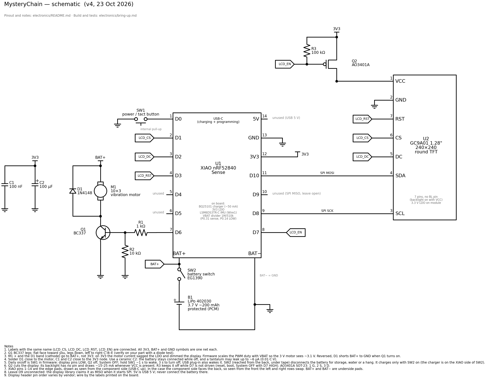
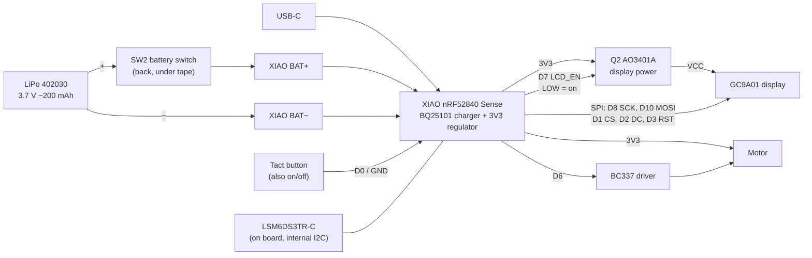

# Electronics

XIAO nRF52840 Sense + GC9A01 round display + coin vibration motor, powered by a small LiPo. Daily on/off is the button, in firmware, with a P-MOSFET (Q2) cutting the display. A slide switch in the battery line (SW2, reached from the back under a piece of tape) disconnects the battery for storage, water or a frozen firmware. No custom PCB: parts are wired point-to-point and soldered in free air inside the case.



- Schematic in [`schematic/`](schematic/) (`schematic.svg/png` transparent, `schematic_white.*` for printing). Bench variant, USB power only (no battery, no SW2) and a PNP (BC327 + 1 kΩ base resistor) as Q2 until the AO3401A is in hand: `schematic_pnp_white.*` (`schematic.py pnp`).
- Step-by-step build and tests: [bring-up.md](bring-up.md). Test sketches: [`tests/`](tests/).
- A custom PCB that replaces the XIAO and the free-air parts is planned: [pcb-brief.md](pcb-brief.md) is the brief for its designer.



## Parts

**Have**

| Part | Qty | Role |
| --- | --- | --- |
| Seeed Studio XIAO nRF52840 **Sense** | 1 | MCU, BLE, IMU (LSM6DS3TR-C), mic, LiPo charger (BQ25101) |
| GC9A01 1.28" 240×240 round TFT module (7-pin) | 1 | The pet's face |
| Shaftless vibration motor 10×3 (wired) | 1 | Haptic feedback |
| BC337 (TO-92) | 1 | Motor switch |

**Still needed**

| Part | Value | Note |
| --- | --- | --- |
| LiPo | **402030**, 3.7 V, ~200 mAh, **protected (PCM)**, with leads | Bay is 21 × 31 × 4.5: length incl. PCM **≤ 31**, thickness **≤ 4.3**. Cut off any JST plug; the XIAO has pads, no connector. |
| Tact button | 3×6 mm, **4.3 mm total height**, 2 legs | Case is drawn for exactly this size. Also the on/off button. |
| P-MOSFET | **AO3401A** (or Si2301), SOT-23 | Q2, cuts the display power. **Required**: without it the backlight draws ~15–25 mA even when "off". |
| Resistor | **100 kΩ** | Q2 gate pull-up, keeps the display off while D7 isn't driven |
| Diode | **1N4148** or B5819W (SOD-123 Schottky) | Motor flyback. 1N5819 works but the DO-41 body is too big. |
| Resistor | **1 kΩ** | BC337 base |
| Resistor | 10 kΩ | Base pull-down, keeps the motor off at boot |
| Capacitor | 100 nF ceramic | 3V3 bypass |
| Capacitor | 100 µF, **≤ 4 mm tall**, **ceramic** 1206/1210 6.3 V | Holds 3V3 up at motor start. A can electrolytic won't fit; avoid tantalum, the battery stays connected while off and it may leak up to ~6 µA. |
| Thin wire | 30 AWG silicone or Kynar wire-wrap, ~1 m | Must pass the 3 mm gap between display and XIAO |
| Heat-shrink | 1–2 mm | For the free-air soldered R, D, Q |
| Double-sided tape | **0.5 mm** foam | XIAO to midframe pad |
| Kapton tape | | Insulates the display back from the XIAO pads; protects the battery |
| Key ring | wire ≤ 2.5 mm | Slot is 3 × 10 mm |
| Filament | **PETG** + **TPU 95A** | PETG for the case (0.7 mm hook arms; PLA may snap), TPU for the tethered USB plug |
| Screen protector | Round, Ø38–40 | Bonded on the front face of the case (v6) |

**Battery switch:** the slide switch from the LilyPad switch board (EG1390), desoldered. Used as SW2 in the battery + line: common pin and one side pin, the other side pin cut off. Check its current rating covers ~200 mA (motor start + display + radio).

**Handy for the bench:** a SOT-23 to DIP adapter board for Q2, or solder three thin wires to it. A SIM eject pin (or a straightened paper clip) for the reset hole in the midframe.

## Pinout

| XIAO pin | nRF52840 | Use | Note |
| --- | --- | --- | --- |
| D0 | P0.02 | Button | Other leg to GND. `INPUT_PULLUP` + debounce. Also wakes the chip from System OFF. |
| D1 | P0.03 | Display CS | |
| D2 | P0.28 | Display DC | |
| D3 | P0.29 | Display RST | |
| D4 / D5 | P0.04 / P0.05 | **Free** | External I2C. The IMU is not on this bus. |
| D6 | P1.11 | Motor | Through 1 kΩ to the BC337 base |
| D7 | P1.12 | Display power (LCD_EN) | Q2 gate, **LOW = display on**. 100 kΩ pull-up to 3V3 keeps it off at reset. |
| D8 | P1.13 | Display SCK | Labeled "SCL" on the module |
| D9 | P1.14 | Don't use | Claimed as SPI MISO |
| D10 | P1.15 | Display MOSI | Labeled "SDA" on the module |
| 3V3 | | Q2 source (display VCC through Q2), motor + | |
| GND | | Common ground | |
| BAT+ / BAT− (underside pads) | | LiPo | BAT+ through SW2, BAT− straight |

Pins used on the board itself (Seeed Arduino variant):

| Pin | Use |
| --- | --- |
| P0.31 | Battery voltage ADC (`PIN_VBAT`) |
| P0.14 | Enables battery sensing (`VBAT_ENABLE`), **LOW = on** |
| P0.13 | Charge current: input (high-Z) = ~50 mA, output LOW = ~100 mA |
| P0.17 | Charge status: LOW = charging |
| P1.08 | IMU power switch |
| P0.11 | IMU INT1 (usable for wake-on-motion) |

**Display:** VCC → Q2 drain, GND → GND, SCL → D8, SDA → D10, DC → D2, CS → D1, RST → D3.

- 7-pin module with **no BL (backlight) pin**: the backlight is on whenever VCC is present.
- The module has its own 3.3 V LDO; feeding it from 3V3 is fine.
- Pin order varies by vendor. Check the labels on your board before soldering.

## Motor driver

D6 → 1 kΩ → BC337 base, 10 kΩ base to GND. Motor between 3V3 and the collector, emitter to GND. Diode across the motor with the **band (cathode) to 3V3**. 100 nF + 100 µF from 3V3 to GND, close to the motor.

- **BC337 legs:** flat face toward you, legs down: **C – B – E** (onsemi). Check your part with a diode test.
- **Why 1 kΩ:** 220 Ω would pull ~12 mA from the pin; the nRF52840 standard drive is ~2 mA (~10 mA in high-drive). 1 kΩ gives ~2.5 mA base current, and BC337-25 (hFE ≥ 160) still carries the 120 mA start current.
- **Motor:** 2.5–3.5 V, ~60 mA running at 3 V, up to 120 mA at start.
- **Firmware:** drive short pulses (100–300 ms). Ignore IMU shake detection for 200–500 ms after the motor stops; its vibration looks like a shake.

## Power

- **Wiring:** battery + → SW2 → XIAO BAT+, battery − → XIAO BAT−. SW2 stays on in daily use; "off" is a firmware state (button).
- **Battery switch SW2:** lies on the midframe beside the XIAO's D0–D6 edge, its actuator reached through a 3.4 × 1.4 slot in the back cover. The tip sits 0.2 below the cover face: push it with a toothpick or a SIM pin. A piece of tape over the slot seals it; peel it to switch. Use it for storage, after water got in, for a frozen firmware and before any soldering.
- **Display switch Q2:** AO3401A source → 3V3, drain → display VCC, gate → D7, 100 kΩ gate to 3V3. D7 LOW = display on. The module has no BL pin, so this is the only way to turn its backlight off. In the case it sits on its own beside the D7/D8 pads, not in the motor driver group.
- **On / off with the button:** hold **3 s** to turn off, hold **~1 s** to turn on. A short tap while off does nothing visible: the chip wakes, sees the button already released and goes straight back off. Plugging in USB also turns it on. Reference code: [`tests/t10_power`](tests/t10_power/t10_power.ino); the scenes in [`interfaces/watch`](../interfaces/watch/) use the same `powerOff()`.
- **What "off" is:** display pins LOW, Q2 off, IMU and mic supplies off, on-board QSPI flash in deep power-down, then nRF52840 System OFF with D0 as the wake pin. Waking is a reset: the firmware starts from scratch, just like after the old switch. Pet stats need flash storage (roadmap O2); the clock resyncs from the phone (A4).
- **Charging:** whenever USB is in and **SW2 is on**, firmware on or off. With SW2 off the charger is cut from the battery: USB then runs the board, but nothing charges. Off, the whole ~50 mA goes into the battery (empty to full in ~4–5 h). On, the display and MCU draw from the same node: charging is slower, and the charger may never report "done" because the load keeps its current above the termination level. For a full charge, plug it in while off.
- **Charge current:** BQ25101 charges at ~50 mA by default (0.25C for 200 mAh, safe). Only enable 100 mA if the battery's datasheet allows 0.5C. Keep the motor off while charging during first tests.
- **Battery voltage:** drive P0.14 LOW, then read P0.31 (1 MΩ / 510 kΩ divider). The divider stays on while off (~3 µA at 4.2 V), part of the off current.

> **Never drive P0.14 HIGH.** P0.31 then sees the full battery voltage; its limit is 3.6 V and it can be damaged. The Seeed core drives it HIGH at boot, so every sketch sets it LOW first thing in `setup()`.

- **Low battery:** below ~3.4 V without USB the firmware turns itself off (T10 does; the scenes get it with roadmap S2). The battery's PCM is the last line of defence.
- **Firmware hangs:** peel the tape, SW2 off and on again. Without USB that is a full power cycle. (With USB in, SW2 doesn't stop it: unplug USB first, or open the cover and press the XIAO reset button with a SIM pin through the hole in the midframe.) A watchdog in the final firmware covers this too.
- **Water got in:** SW2 off at once, unplug USB, open and dry it. With SW2 off nothing inside is live, so nothing corrodes from the battery.
- A full cell is ~4.2 V. Never connect raw BAT+ to the display or motor; both run from 3V3.
- If the battery swells, gets hot or smells, turn SW2 off, take it out and don't use it again. The 0.5 mm swelling allowance means a swollen battery will push on the cover.

**Power budget** (estimates, not measured):

| Load | Current |
| --- | --- |
| Display backlight + driver | ~15–25 mA, continuous (no BL pin) |
| nRF52840 (drawing + BLE) | ~3–6 mA active, lower on average while advertising |
| IMU | ~0.5 mA |
| Motor | 60 mA, only during pulses |
| **Off** (System OFF, Q2 off, flash asleep) | **~3–15 µA** (estimate; the nRF52840 itself 0.4 µA, divider ~3 µA; a bare XIAO measured ~2.4 µA) |

With 200 mAh and the display always on: **~7–10 h**. The GC9A01 sleep command cuts the driver current, but **the backlight stays on**; only Q2 removes it. Off, the battery lasts well over a year (LiPo self-discharge is then the bigger loss). Without the flash in deep power-down the off current is ~25 µA higher. Measure all of it in bring-up T9.

## Firmware notes

- **IMU** is on the internal `Wire1` bus, not on D4/D5. Its power (P1.08) is switched on by the Seeed library. INT1 (P0.11) can wake on motion.
- **Core:** Seeed nRF52 Boards (not "mbed-enabled"). Pin names follow the variant file: `VBAT_ENABLE`, `PIN_VBAT`, `PIN_CHARGING_CURRENT`, `PIN_LSM6DS3TR_C_POWER`.
- **Antenna:** the XIAO antenna end is ~2.5 mm from the motor's metal body, 3 mm behind the display PCB, ~25 mm from the key ring. Check BLE range with the case closed.
- **Off:** System OFF wakes on D0 only (IMU INT1 could be added for wake-on-motion, but the IMU then stays powered). Never call `systemOff()` with the button still pressed. Reset reason after a wake: `readResetReason()` bit `POWER_RESETREAS_OFF_Msk` (button) or `POWER_RESETREAS_VBUS_Msk` (USB). The upstream Adafruit bootloader doesn't clear it; T10 shows what yours does.
- **Motor pin:** call `digitalWrite(MOTOR, LOW)` right after `pinMode(MOTOR, OUTPUT)`. This core presets every output HIGH, and pin states are kept in System OFF.
- **Display:** every sketch drives D7 LOW and waits ~50 ms before `tft.begin()`.

## Regenerate the schematic

```bash
cd schematic
python3 -m venv .venv && .venv/bin/pip install schemdraw matplotlib
.venv/bin/python schematic.py    # also checks the netlist against the expected connections
```
