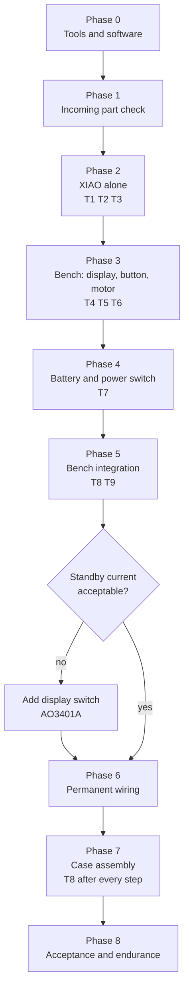

# Bring-up

How to build the electronics step by step and test each part before it goes into the case. Wiring and pinout: [README.md](README.md). Test sketches: [`tests/`](tests/) (all compile for "Seeed XIAO nRF52840 Sense").

Each phase ends with a **pass condition**. Don't move on until it holds. When something breaks, suspect the last thing you added: it's the only thing that changed.



## General rules

- **Add one thing at a time.** Add, test, then the next.
- **After every solder job, check for shorts before powering up:** multimeter on Ω, across 3V3–GND and BAT+–BAT−. Below a few Ω = short; don't plug in USB or the battery. With capacitors fitted the reading starts low and climbs; that's normal.
- **Power switch OFF** whenever you solder with the battery attached.
- **Write every measurement into the [log](#measurement-log).** Later phases use these values.

## Phase 0: Tools and software

**Tools:** fine-tip iron (~320–350 °C; a fat tip bridges the small XIAO pads), flux, 0.5 mm solder, multimeter (Ω, diode, DC V, DC mA), breadboard, 1×10 male header strip, tweezers/cutters/stripper, calipers, heat source for heat-shrink, optional 2×AA holder (3 V to test the motor alone).

**Software:**

1. Install **Arduino IDE 2**.
2. *File → Preferences → Additional boards manager URLs*: `https://files.seeedstudio.com/arduino/package_seeeduino_boards_index.json`
3. *Boards Manager*: install **Seeed nRF52 Boards** (tested 1.1.13). **Not** the "mbed-enabled" one: `VBAT_ENABLE`, `PIN_VBAT`, `systemOff()` and the Bluefruit BLE library come from the non-mbed core.
4. Board: **Seeed XIAO nRF52840 Sense**. The non-Sense board has no IMU.
5. *Library Manager*: **Adafruit GC9A01A** (tested 1.1.1) and **Seeed Arduino LSM6DS3** (tested 2.0.7). Accept their dependencies (Adafruit GFX, BusIO).
6. **Linux only:**

   ```bash
   pip3 install --user adafruit-nrfutil   # not shipped for Linux; even compiling calls it
   sudo apt install python-is-python3     # the core builds UF2 via 'python'
   sudo usermod -aG dialout $USER         # serial port access; log out and back in
   ```

**Upload stuck?** Double-tap the XIAO reset button. It enters the bootloader, shows up as a drive, and the serial port may change. Pick the new port and upload again.

## Phase 1: Incoming part check

Measure each part on its own before soldering anything.

| Part | How | Pass |
| --- | --- | --- |
| XIAO | Plug into USB, measure 3V3–GND | Computer sees it, 3V3 = 3.25–3.35 V |
| Display | Read pin labels; Ω across VCC–GND | Labels VCC GND SCL SDA DC CS RST; VCC–GND not shorted |
| Motor | Ω across leads, then 3 V from 2×AA for **1 s** | Neither open (OL) nor ~0 Ω; vibrates |
| BC337 | Diode mode, red on the middle leg (B), black on each outer leg; then both ways across the outer legs | B→E and B→C: 0.6–0.75 V; C↔E: OL both ways. Different readings = different pinout, check the datasheet. hFE 100–630 if your meter has a socket. |
| 1N4148 | Diode mode, red on the unbanded end (anode) | 0.5–0.7 V forward, OL reverse. **Band = cathode.** |
| B5819W (if used) | Same | 0.15–0.35 V forward |
| Resistors | Ω | 1 kΩ: 0.95–1.05 k; 10 kΩ: 9.5–10.5 k |
| Capacitors | Capacitance mode if available | Roughly right; ceramic 100 µF may read tens of % low. **On tantalum the band is +**, the opposite of electrolytics. |
| Slide switch | Ω across the two sew tabs, both positions | ON ~0 Ω, OFF OL |
| Button | Ω across the legs | Pressed ~0 Ω, released OL |
| LiPo | DC V at the leads. **Don't let them touch.** | 3.6–4.2 V, + on red; protection PCB present; size ≤ 31 × 20.5 × 4.3 |

Don't use a battery below 3.0 V. Also finish the caliper list in [mechanical/README.md](../mechanical/README.md#to-measure-assumptions-in-the-cad).

**Pass:** every row passes and you know your BC337 pinout.

## Phase 2: XIAO alone

USB cable only, nothing soldered.

- **T1 Upload:** *File → Examples → 01.Basics → Blink*. **Pass:** red LED blinks once a second; uploads work every time.
- **T2 IMU** ([`tests/t2_imu`](tests/t2_imu/t2_imu.ino)). The IMU is on the internal `Wire1` bus; the library powers it. **Pass:** flat on the table `a` is 0.97–1.03 and `az` ≈ ±1; gyro below 5 at rest; turning 90° moves 1 g to another axis; a light shake gives `shake:1`, never at rest.
- **T3 BLE** ([`tests/t3_ble`](tests/t3_ble/t3_ble.ino)). **Pass:** nRF Connect lists "MysteryChain" and connects. Log the RSSI at 1 m; phase 7 compares against it.

## Phase 3: Bench prototype

**Don't solder headers to the XIAO.** The case has 4.51 mm for it, headers don't fit, and removing a 14-pin header later risks lifting pads. Instead, **solder the permanent wires to the pads now, but long** (~12 cm), with one male header pin on each free end (heat-shrunk) for the breadboard. In phase 6 you shorten them; the XIAO joints never change. Flag each wire with tape naming its pin.

Plug the display straight into the breadboard (pins down) and run the XIAO wires to its rows. Solder header pins to the motor leads.

Pad soldering: tin the pad, strip and tin 2 mm of wire, join, touch ~1 s. Check for bridges with a magnifier.

| XIAO pad | Bench | Permanent (phase 6) |
| --- | --- | --- |
| D0 | Button leg 1 (leg 2 → GND rail) | Button |
| D1 / D2 / D3 | Display CS / DC / RST | same |
| D6 | 1 kΩ → BC337 B | same |
| D8 / D10 | Display SCL / SDA | same |
| 3V3 (wire a) | Display VCC | same |
| 3V3 (wire b) | + rail | Motor driver + node |
| GND (wire a) | Display GND | same |
| GND (wire b) | − rail | Motor driver − node and button |

Two wires each on 3V3 and GND. D4, D5, D7, D9 stay free. Nothing on 5V.

- **T4 Display** ([`tests/t4_display`](tests/t4_display/t4_display.ino)), only the 7 display wires. **Pass:** colors come in the order printed on serial; edge circle equally thick and unbroken; counter runs **30 min** without snow, shift or freeze. Log the "full screen" time (~120–150 ms at 8 MHz).
- **T5 Button** ([`tests/t5_button`](tests/t5_button/t5_button.ino)), D0 ↔ GND. **Pass:** 20 presses count exactly 20; under 600 ms = SHORT, longer = LONG. "raw edges" above 2 is bounce the debounce already filters; replace the button if it's always above 10.
- **T6 Motor driver** ([`tests/t6_motor`](tests/t6_motor/t6_motor.ino)). Build it on the breadboard with your phase 1 pinout: D6 → 1 kΩ → B, 10 kΩ B–E, E → GND, motor + → 3V3, motor − → C, diode across the motor (**band to 3V3**), 100 nF + 100 µF across 3V3–GND.

  > **Don't reverse the diode.** Reversed, it shorts 3V3 to GND through the transistor as soon as it turns on. Check it again before powering up.

  During `h` (3 s on) measure: B–GND 0.7–0.85 V, C–E < 0.3 V, 3V3 ≥ 3.2 V. **Pass:** clear vibration on 1/2/3; no new "BOOT" line during `s`; BC337 no more than warm after the stress; readings in range.

## Phase 4: Battery and power switch

> **LiPo safety:** never let the leads touch. Cut leads **one at a time** and insulate each right away. If the battery gets hot, swells or smells, disconnect and don't use it again.

Keep the switch on its LilyPad board for now (use the two sew tabs); it's desoldered in phase 6.

1. Find the battery's + lead with the meter (don't trust the color) and flag it.
2. Switch **OFF** until all wiring is done.
3. Solder a wire to the XIAO BAT+ pad (underside) and to one switch tab; another wire to BAT−.
4. Battery + to the other switch tab, battery − to the BAT− wire.
5. Tape the battery wires to the XIAO with Kapton; a tug can rip the small BAT pads off.
6. No USB, switch ON, measure BAT+–BAT−: **positive battery voltage**. Negative? Switch OFF at once and fix it.

**T7 Battery** ([`tests/t7_battery`](tests/t7_battery/t7_battery.ino)). The sketch drives P0.14 LOW first thing (see [Power](README.md#power)); the divider then draws only ~3 µA.

Calibrate: switch ON, USB in, meter on BAT+/BAT−, compare with serial. `VBAT_CAL = meter / reading`; write it into T7 and T8.

**Pass:** after calibration within 30 mV of the meter; "CHARGING" with switch ON and USB in; "not charging" when full, VBAT 4.15–4.20 V (200 mAh at 50 mA charges from empty in ~4–5 h, battery no more than warm); unplug USB and T4 runs 30 min on battery; switch OFF without USB = board fully dark.

## Phase 5: Bench integration

**T8 Integration** ([`tests/t8_integration`](tests/t8_integration/t8_integration.ino)). Everything at once, all status on screen so it also works with the case closed (phase 7). Shows reset reason and IMU status for 2 s at boot. If the uptime restarts, the board reset (likely a supply dip on a motor pulse while on battery). Run on USB first, then battery only.

| Test | Pass |
| --- | --- |
| 20 short presses | 20 motor pulses, `btn 20`, uptime never restarts |
| 3 long presses (30 pulses), **on battery** | Uptime never restarts, no screen glitches |
| Motor → IMU tail (USB, serial open) | Repeat short presses on the table and in hand. Largest "IMU tail" + 100 ms → `MOTOR_MASK_MS`. Pressing the button must not count shakes. |
| Shake | `shake` counter goes up, face toggles happy/sad |
| 30 min on battery | No freeze or reset; log the VBAT drop |

On the bench the motor sits loose; in the case it couples more vibration into the IMU, so `MOTOR_MASK_MS` is measured again in phase 7.

**T9 Current** ([`tests/t9_current`](tests/t9_current/t9_current.ino)). Meter on **DC mA across the switch tabs**, switch OFF (the meter replaces the switch). **No USB.** Don't change the range mid-test: the circuit opens and the board resets. Each button press steps through the states:

| State | Estimate (not measured) | Measured |
| --- | --- | --- |
| 1. White screen | ~20–30 mA | |
| 2. Black screen | close to 1 (same backlight) | |
| 3. Display asleep | ~15–25 mA (backlight stays on) | |
| 4. Asleep + BLE advertising | slightly above 3 | |
| 5. System OFF | ≈ 3 (MCU stopped, display still powered) | |

Battery life (h) ≈ 200 mAh × 0.8 / measured mA.

**Decision:** if state 5 is above 1 mA, the pet drains the battery in hours even while "asleep" (~11 h at 15 mA). Either:

- **a)** switch it fully off with the power switch when not in use. No hardware change, but the pet can't keep its state (time, hunger…) while off; or
- **b)** add the display switch (AO3401A + 100 kΩ on D7, see [Power](README.md#power)). It's soldered in the passives zone in phase 6. Then set `HAS_DISP_SWITCH = true` in T9 and measure again: state 5 should drop to µA (use the µA range).

**Pass:** all 5 states measured, the button wakes it from System OFF (starts white), a/b decided.

## Phase 6: Permanent wiring

The printed case must be ready. **Measure wire lengths in the printed case**, don't guess.

1. **Dry fit:** display, XIAO (no tape) and midframe in the case. Measure each wire route, add 5 mm. Routes: passives on +X, button on −X, battery wire through the 3.5 mm pass-through.
2. **Desolder the switch** from the LilyPad board. Re-check continuity in both positions, find common and ON legs, cut the unused leg.
3. **Motor driver in free air (dead-bug):** shorten the BC337 legs and lay it on its side; 10 kΩ across B–E, 1 kΩ to B; diode band to the + node (3V3), other end to C; 100 nF and 100 µF across + and −. Heat-shrink every joint, then wrap the group in Kapton. **Total height ≤ 4.3 mm.** Option b: AO3401A + 100 kΩ go here too.
4. Short check, then USB and T6.
5. **Shorten the display wires.** Solder them *beside* the header pins; don't cut the pins. Short check, then T4. With short wires also try `SPI_HZ = 0` (library default); if clean, use it in T8 too.
6. **Button and switch.** Short check, then T5.
7. **Full regression:** T8 on battery, every phase 5 test.

**Pass:** the T8 table passes end to end on battery with permanent wiring. No joint without heat-shrink.

## Phase 7: Case assembly

Same order as [mechanical assembly](../mechanical/README.md#assembly), with T8 running after every step. USB upload works with the case closed; a bootloader double-reset needs the cover off (the reset button faces the midframe).

| Step | Assembly | Then |
| --- | --- | --- |
| 1 | Display from the back: tab first, then PCB onto the step | T8 boots, text not clipped at the edge |
| 2 | Switch and button into their wall holes | By hand: switch moves both ways, button clicks |
| 3 | XIAO taped to the pad, motor in its cup, midframe in | T8 short and long presses. **Re-measure the IMU tail**, update `MOTOR_MASK_MS`. |
| 4 | Battery between the ribs, wire through the pass-through | T7: VBAT correct, no pinched wires |
| 5 | Back cover: tab end first, then the disc | Closed-case tests below |

**Closed-case tests:** switch and button work from outside and `btn` counts; USB plug goes all the way in and "CHG" shows with switch ON; 4 perimeter + 2 tab hooks seated, cover opens at the 225° notch; T3 RSSI at 1 m vs. phase 2 (more than 10 dB worse: rethink antenna clearance to motor and display) and the distance where the link drops; T8 for 30 min then charge, case no more than warm.

**Pass:** all closed-case tests pass; final `MOTOR_MASK_MS` logged.

## Phase 8: Acceptance and endurance

| Test | How | Pass |
| --- | --- | --- |
| Full discharge | Charge fully, run T8 (or final firmware) without USB until the screen dies | Runtime within ±30% of the T9 estimate; last VBAT logged |
| Full charge | Empty battery, switch ON + USB | "CHG" disappears after ~4–5 h, battery not even warm |
| 24 h run | T8 on USB | No freeze, uptime past 86400 |
| Shake | Shake hard for 1 min, then T8 | Nothing changed; no loose-wire symptoms (flicker, reset) |
| Drop | 5 × from 50 cm onto carpet, then T8 | Case stays closed, T8 intact |
| Keyring pull | Pull hard on the ring | Lug and bridge don't flex, T8 unaffected |
| Battery check | Open the cover after the tests | No swelling |

The XIAO has no software low-voltage cutoff; the battery's own PCM cuts it at the end. Final firmware should switch the display off and enter System OFF below ~3.4 V, but without option b the display still draws current in System OFF, so the PCM ends up cutting it anyway.

**Carry into the final firmware:** `VBAT_CAL`, `MOTOR_MASK_MS`, `SPI_HZ`, pulse length, low-battery threshold, P0.14 always LOW.

## Troubleshooting

| Symptom | Likely cause → fix |
| --- | --- |
| `adafruit-nrfutil` not found when compiling | Linux: `pip3 install --user adafruit-nrfutil`, restart the IDE |
| `exec: "python": executable file not found in $PATH` | `sudo apt install python-is-python3`, restart the IDE |
| `undefined reference to Serial` | Add `#include <Adafruit_TinyUSB.h>` (the test sketches have it) |
| No port, upload hangs | `dialout` group, a data-capable USB cable, double reset |
| Display all white or black | VCC/GND, swapped CS/DC, RST; try `SPI_HZ = 4000000` |
| Colors inverted | Add `tft.invertDisplay(false)` (or `true`) after `tft.begin()`; module-dependent |
| "NO IMU" | Board set to "Sense"? Non-mbed core installed? |
| Motor doesn't run | BC337 pinout; B–GND 0.7 V during `h`? Broken motor lead? |
| Motor always on | Missing 10 kΩ, or C and E swapped |
| Board resets on motor pulses (uptime restarts) | 100 µF close to the motor and 3V3 node? Battery cold or empty? Shorten the pulse, or soft-start with PWM in firmware. |
| Nonsense VBAT (0 or > 5000 mV) | P0.14 LOW? Battery attached? (On USB without a battery it reads the charger output.) |
| BLE not visible | Phone location/Bluetooth permission; try `setTxPower(4)` in T3 |

## Measurement log

| Test | Measurement | Value | Date |
| --- | --- | --- | --- |
| Phase 1 | XIAO 3V3 (USB) | | |
| Phase 1 | BC337 pinout / hFE | | |
| Phase 1 | Battery voltage as received, measured size | | |
| T2 | `a` at rest / gyro offset | | |
| T3 | RSSI at 1 m (bare board) | | |
| T4 | Full-screen fill time (8 MHz / default) | | |
| T6 | V_BE / V_CE(sat) / 3V3 with motor on | | |
| T7 | `VBAT_CAL` | | |
| T7 | Charge time (empty to full) | | |
| T8 | `MOTOR_MASK_MS` (bench / case) | | |
| T8 | VBAT drop over 30 min | | |
| T9 | Current: state 1 / 2 / 3 / 4 / 5 | | |
| T9 | Option a/b | | |
| Phase 7 | RSSI at 1 m (closed case) / drop-out distance | | |
| Phase 8 | Full discharge time / VBAT at shutdown | | |
