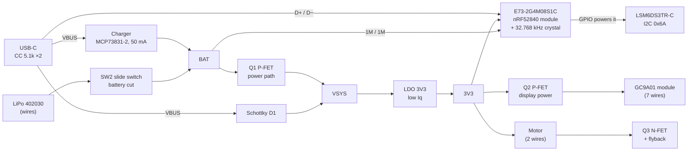

# PCB design brief

A brief for whoever designs the MysteryChain board. It says what the board has to do, where it has to fit, and which parts we already found in Turkey. Layout, routing and the final part picks are yours. Where this brief says **must**, ask before changing it. The rest are suggestions.

## What the product is

A keychain virtual pet: a 1.28" round display, BLE to a phone app, an IMU (steps, taps, tilt), a vibration motor and one button, in a Ø42.2 × 13.7 mm 3D-printed case with a keyring lug, powered by a ~200 mAh LiPo.

Today it is a hand-wired prototype. The MCU board is a Seeed XIAO nRF52840 Sense, and the display, motor driver, display power switch and battery switch are soldered in free air around it. See [README.md](README.md), the [schematic](schematic/schematic_white.png) and the [case](../mechanical/README.md). Each unit takes hours to wire, the XIAO is expensive and often out of stock in Turkey, and no two builds are the same.

**The PCB replaces the XIAO and all the free-air parts.** The display module, battery and motor stay off-board, on wires.

## Goals

| # | Goal | Must / should |
| --- | --- | --- |
| 1 | Every current feature works with the same firmware behaviour: display, BLE, IMU pedometer + tap, motor, button with on/off, battery %, charge status, System OFF | must |
| 2 | Off current **≤ 10 µA** (battery switch on, nRF52840 in System OFF) | must |
| 3 | Fits the case with small changes (see [Case fit](#case-fit)) | must |
| 4 | **Hand-solderable** by the owner: iron, flux, hot air or a hotplate. No reflow oven. Only the IMU should need hot air | must |
| 5 | **Testable:** a test pad on every rail and key signal, SWD pads, populate-and-test in stages | must |
| 6 | Parts available in Turkey (customs is the main cost; the €30 duty-free limit is gone). Each part has a TR source or a named alternative | must |
| 7 | USB-C plug force goes into the case, not into solder joints | must |
| 8 | Ready for a 100–1000 unit run later: standard packages, fiducials, test pads a pogo jig can reach | should |
| 9 | Lowest cost that meets the rest | should |

**Quantity:** prototype 2 is 1–10 boards, hand-assembled. Series production comes later.

**Out of scope:** bare display panel on an FPC (next revision), microphone, QSPI flash, NFC antenna, LEDs, waterproofing.

## Block diagram

### Power path

Adafruit Feather style, so the charger sees only the battery and reports "done" correctly (the XIAO can't: its load sits on the battery).

- **USB in:** VSYS = VBUS − D1 drop. Q1 is off. The charger charges the battery alone.
- **USB out:** Q1 is on, VSYS ≈ battery.
- **Q1** (P-FET): source = VSYS, drain = BAT, gate = VBUS with 100 k to GND. The body diode must point BAT → VSYS.
- **Charge current** 50 mA (PROG 20 k), 0.25C for 200 mAh. Fixed, no pin needed.
- **3V3 LDO:** low quiescent current (the off-current budget), ≥ 200 mA, stable with the 100 µF ceramic on 3V3. Check that against its datasheet.

### Display power

The GC9A01 module has **no backlight pin**: the backlight is lit whenever VCC is there (~15–25 mA). Q2 (P-FET, high side) is the only way to turn it off. Gate on an MCU pin with 100 k to 3V3, so the display stays off until the firmware drives the pin LOW. **LOW = display on.**

### Motor

Low side N-FET (Q3) with 100 k gate pull-down, so the motor stays off at boot. Motor between 3V3 and the drain, flyback diode across it (cathode to 3V3), 100 nF across the motor, 100 µF ceramic on 3V3 near it. The motor is 2.5–3.5 V, ~60 mA running, up to ~120 mA at start. **Risk:** a start pulse can brown out a slow low-Iq LDO. Measure 3V3 at motor start in bring-up; if it dips, rev B runs the motor from VSYS with PWM.

### IMU

The firmware uses the LSM6DS3TR-C's **hardware pedometer and tap detection**, so the IMU must be that chip (or one with the same registers, see the parts table). It is powered from a GPIO (VDD, VDDIO and the I2C pull-ups all on that pin, like the XIAO does), so it draws 0 µA when off and the pull-ups can't back-power it. SA0 to GND (address 0x6A), CS to VDDIO (I2C mode), 100 nF at the chip. INT1 to an MCU pin through an **open solder jumper**, for wake-on-motion later.

**Orientation:** record the IMU's rotation on the board and which side it is on. If it lands on the other side than the XIAO's IMU, its Z axis flips; the firmware maps the axes in the board variant. Keep it axis-aligned (0/90/180/270°).

### Battery voltage

1 M / 1 M divider from BAT to an ADC pin, 100 nF at the pin, always on (~2 µA at 4.2 V, part of the off budget). No enable pin: unlike the XIAO, nothing can put the full battery voltage on the pin.

## MCU module

**Ebyte E73-2G4M08S1C**, exactly the **S1C** variant (the S1E lacks P1.11). It is the same nRF52840 as the XIAO, so the firmware and SoftDevice carry over. 13 × 18 × 3.0 mm, castellated pads, ceramic antenna, FCC/CE.

- The DC-DC inductors are inside the module. VDD and VDDH both on 3V3 (normal voltage mode), DCCH not connected.
- The module has **no** 32.768 kHz crystal (manual §2.2). Add one on XL1/XL2. The firmware can fall back to the RC oscillator if it doesn't start.
- **Use only the castellated edge pads**, so the module can be soldered with an iron. Leave the inner pads unconnected. Don't put vias at the ends of the castellated pads: solder wicks into them.
- **Antenna at a board edge**, away from the battery (+Y), the USB shell (−Y) and the motor (in the lug). The +X edge is the only one that is free. No copper on any layer under the antenna and 2 mm around it; it may overhang the edge.
- Manual §5.1 asks for no traces under the module. On a 4-layer board a solid GND plane between the module and the inner signal layers is a fair answer.

The bootloader goes on once over SWD (owner does this). After that, uploads go over USB like on the XIAO.

## Pin map

This map keeps the firmware port to a new board variant plus a few `#ifdef`s. Display, button and motor keep their XIAO GPIOs where the E73 exposes them. **Ask before changing it**; a change is fine if it makes the board route, it just has to be agreed.

| E73 pad | nRF52840 | Net | Note |
| --- | --- | --- | --- |
| 7 | P0.02 | BTN | Button to GND, internal pull-up. System OFF wake pin. Same as XIAO D0 |
| 3 | P0.03 | LCD_CS | Same as XIAO D1 |
| 4 | P0.28 | LCD_DC | Same as XIAO D2 |
| 8 | P0.29 | LCD_RST | Same as XIAO D3 |
| 6 | P1.13 | LCD_SCK | Same as XIAO D8. SPI at 32 MHz |
| 10 | P0.30 | LCD_MOSI | XIAO used P1.15, which the E73 doesn't expose |
| 2 | P1.10 | LCD_EN | Q2 gate, 100 k to 3V3, LOW = display on |
| 1 | P1.11 | MOTOR | Q3 gate, 100 k to GND. Same as XIAO D6 |
| 9 | P0.31 / AIN7 | VBAT_ADC | 1 M / 1 M from BAT, 100 nF. Same ADC pin as the XIAO |
| 15 | P0.05 | IMU_SCL | 4.7 k pull-up to IMU_PWR |
| 17 | P1.09 | IMU_SDA | 4.7 k pull-up to IMU_PWR |
| 33 | P0.13 | IMU_PWR | Powers the IMU and its pull-ups (high drive) |
| 35 | P0.24 | CHG_STAT | Charger STAT through 10 k / 15 k (STAT pulls up to VBUS when done) |
| 41 | P0.09 / NFC1 | IMU_INT1 | Through an open solder jumper |
| 43 | P0.10 / NFC2 | — | Test pad only |
| 11, 13 | P0.00, P0.01 | XL1, XL2 | 32.768 kHz crystal |
| 26 | P0.18 | RESET | Reset button to GND + SWD pad |
| 37, 39 | | SWDIO, SWCLK | SWD pads |
| 27, 29, 31 | | VBUS, D−, D+ | From the USB-C, 4.7 µF on VBUS |
| 19, 23 | | VDD, VDDH | Both 3V3. 4.7 µF + 100 nF |
| 25 | | DCCH | Not connected |
| 5, 21 | | GND | |

Display wire order (GC9A01 module labels): **VCC, GND, SCL, SDA, DC, CS, RST**. SCL = LCD_SCK, SDA = LCD_MOSI, VCC = Q2 drain. Pin order differs between module vendors, so match the pads to our module's tab.

## Parts

All of these were looked up at Turkish shops on 2026-10-21. Prices change; stock changes faster. Where a part has no TR stock, the alternate column is the plan.

| Ref | Part (MPN) | Package | Role | TR source (2026-10-21) | Alternate |
| --- | --- | --- | --- | --- | --- |
| U1 | Ebyte **E73-2G4M08S1C** | 13×18 castellated | MCU + BLE | Robiz, 265.50 TL | — |
| Y1 | RT3215-32.768-12.5-TR (CL 12.5 pF, 20 ppm) + 2× 22 pF C0G | 3215 | LF crystal | direnc.net, 9.76 TL | ECS-.327-7-12R-TR (CL 7 pF) with 10 pF caps, e-komponent 47.12 TL |
| U2 | ST **LSM6DS3TR-C** | LGA-14 2.5×3 | IMU | ❓ bare chip not stocked in TR (only the Adafruit 4503 breakout, 739.95 TL) | **LSM6DSLTR**, e-komponent 299.85 TL: same pinout and WHO_AM_I 0x6A, but the pedometer/tap registers differ, so the firmware needs a check first |
| U3 | Microchip **MCP73831T-2ACI/OT** | SOT-23-5 | LiPo charger | e-komponent 54.26 TL | — |
| U4 | Microchip **MCP1700T-3302E/TT** | SOT-23 | 3V3 LDO, 250 mA, 1.6 µA Iq | ❓ out of stock at direnc.net and e-komponent | **XC6206P332MR-G**, e-komponent 44.26 TL, same pads (1 GND / 2 OUT / 3 IN) |
| Q1, Q2 | **AO3401A** | SOT-23 | Power path, display switch | e-komponent 37.12 TL | Si2301 |
| Q3 | **AO3400A** | SOT-23 | Motor switch | e-komponent 38.67 TL | Si2302 |
| D1 | **B5819W** | SOD-123 | VBUS → VSYS | direnc.net 3.49 TL | (SS14 is SMA, not pin-compatible) |
| D2 | **1N4148WS** | SOD-323 | Motor flyback | direnc.net 0.41 TL | — |
| J1 | **GCT USB4105-GF-A** | USB-C 16P top mount | USB 2.0 + charging | e-komponent 57.11 TL | USB4105-GF-A-060 / -120 (same footprint, longer posts) |
| SW1 | **C&K KMS221GP LFS** | side-actuated SMD | User button (also on/off) | e-komponent 54.29 TL | — |
| SW2 | **E-Switch EG1390** | SMD slide | Battery switch, reached through a slot in the back cover | ❓ not listed in TR; owner has 1 | e-komponent quote request |
| SW3 | **C&K PTS810SJK250SMTRLFS** | SMD tact, 2.5 mm tall | Reset / bootloader (double press) | e-komponent 41.41 TL | KMR221G (49.83 TL, own footprint) |
| C6 | Murata GRM31CR60J107KEA8L, 100 µF 6.3 V X5R | 1206 | 3V3 bulk for motor start | e-komponent 32.84 TL | **Ceramic only**: no tantalum (leaks µA), electrolytic doesn't fit |
| R, C | 1 % thick film, X5R/X7R 10 V, C0G for pF | 0603 | | direnc.net / e-komponent | 0603 keeps hand rework easy |

Passives:

| Ref | Value | Between | Role |
| --- | --- | --- | --- |
| R1, R2 | 5.1 k | CC1, CC2 → GND | USB-C sink |
| C1 | 4.7 µF | VBUS | |
| R3 | 20 k | PROG → GND | 50 mA charge |
| C2 | 4.7 µF | BAT | |
| R4, R5 | 10 k, 15 k | STAT → CHG_STAT → GND | STAT level to 3 V |
| R6 | 100 k | VBUS → GND | Q1 gate |
| C3 | 1 µF | VSYS | |
| C4, C5 | 4.7 µF, 100 nF | 3V3 | LDO out, module |
| C8, C9 | 22 pF | XL1, XL2 → GND | Crystal load (match to the crystal's CL) |
| R11, R12, C13 | 1 M, 1 M, 100 nF | BAT → VBAT_ADC → GND | Battery voltage |
| C10 | 100 nF | IMU_PWR | IMU |
| R7, R8 | 4.7 k | SDA, SCL → IMU_PWR | I2C pull-ups |
| R9 | 100 k | LCD_EN → 3V3 | Display off at reset |
| R10 | 100 k | MOTOR → GND | Motor off at reset |
| C12 | 100 nF | across the motor | |

Off-board, on wires: the GC9A01 1.28" 240×240 module (7 wires), the LiPo 402030 with its protection board (2 wires), the 10×3 mm coin vibration motor (2 wires).

Before ordering, check every pinout against its own datasheet, and lay the real E73, USB-C and IMU on a 1:1 paper print of their footprints.

## Case fit

The case is parametric ([`mechanical/pet_case.step.py`](../mechanical/pet_case.step.py)), and a small revision (case v8) will be made around your board. The body, lug, battery bay, display seat and USB-C position stay. [`mechanical/pet_case.step`](../mechanical/pet_case.step) is the full assembly, import it into any CAD.

**Coordinates** (case): origin at the display centre, looking at the display. +Y toward the keyring lug, −Y toward the USB-C, −X button wall. "Front" = display side of the board, "back" = midframe side.

### Space

| Where | Height available |
| --- | --- |
| Board thickness | **1.0 mm** suggested. 1.6 mm costs 0.6 mm of case thickness |
| Back side (toward the midframe) | **3.5 mm** for parts, measured from the board's back face. The E73 (3.0) and the USB-C (3.31) live here |
| Front side (toward the display) | **≤ 1.2 mm** parts. The display PCB is 3.25 mm away, and its tallest rear part (an LDO) is ≤ 1.45 mm |

### Outline

- A circle of **r = 18.0**, cut flat at **y = +7.0**. The battery bay starts at y = 7.1. The cover's hook arms sit at r 18.25–18.95.
- A tongue down to **y = −18.2** for the USB-C.
- Two **Ø3.0 notches** at r = 17.6, 205° and 335°, for the midframe's display clamp legs.

Measured from the footprint libraries, the parts' courtyards add up to ~712 mm² and the board is ~754 mm², so **parts go on both sides**.

### Positions that are fixed by the case

| Item | Where | Note |
| --- | --- | --- |
| USB-C (J1) | Face on **y = −18.2, x = 0**, opening −Y, back side | Same position and height as the XIAO's USB-C. Fix it in the case with two Ø2.0 NPTH holes beside it for case locating pins (the last attempt used (±6.2, −14.8)), so the plug force goes into the case |
| Button (SW1) | Plunger toward the **−X wall at y ≈ 0** | The wall hole moves to the plunger height in case v8 |
| Battery switch (SW2) | Body around **x −13 … −9.5, y −10.5 … −3.5**, back side, slide along Y | The actuator goes back through a slot in the midframe and the cover. Moving it 1 mm is fine |
| Reset (SW3) | Back side, reachable through a hole in the midframe | The hole moves to wherever SW3 ends up |
| Wire pads | Along the **+Y edge**, labelled, ≥ 2.0 mm pitch | Display 7, battery 2, motor 2. Battery and motor wires go back into the lug |
| E73 antenna | **+X edge** | See [MCU module](#mcu-module) |

The board sits on midframe standoffs and is clamped by the front housing. Case v8 removes the XIAO's pin rails and adds the standoffs and a ledge; tell us where you need them, or where they can't go.

## Testability

- **Test pads** Ø1.0 on one side (the front, so a pogo jig and probes reach them with the tall back parts facing down):
  - rails: VBUS, VSYS, BAT, BATT_RAW, 3V3, LCD_VCC, IMU_PWR, GND ×2;
  - signals: CHG_STAT, MOTOR_SW (Q3 drain), BTN, IMU_SDA, IMU_SCL, P0.10.
- **Both sides of SW2** on pads, so the off current can be measured with SW2 open and the meter across it.
- **SWD:** a 5-pad row at 2.54 mm, **3V3, SWDIO, SWCLK, RESET, GND**, for a pogo clip or a held header.
- Fiducials (two per populated side if they fit), refs on silkscreen, board name and revision.

Bring-up will go in stages, so the board must work partly populated:

1. Bare board: no short on 3V3, VBUS, BAT to GND.
2. Power only (USB-C, charger, LDO, Q1, D1, passives): VBUS 5.0, VSYS ~4.7, 3V3 3.30. Then a bench supply on BAT.
3. \+ E73, crystal, reset: bootloader over SWD, USB enumerates.
4. \+ IMU: WHO_AM_I reads 0x6A.
5. \+ Q2 and display, + Q3 and motor, + buttons and battery.
6. Currents with SW2 open: System OFF ≤ 10 µA, display on ~20–30 mA, no brownout at motor start.
7. Charge: 50 mA, CHG_STAT goes LOW → HIGH at termination.
8. In the case: fit, USB plug in/out 20 times, BLE range ≥ 10 m with the case closed, compared with the XIAO build.

## Fab

| Fab | Notes |
| --- | --- |
| **İzmir PCB, import line** ([capabilities](https://www.izmirnumunepcb.com/pcb-teknik-uretim-kabiliyeti-becerileri.html), calculator at pcbfiyathesaplama.com) | Turkish company, they handle customs. 0.15 / 0.15 mm track/space, 0.3 mm drill, 0.6–2.4 mm thick. 4-layer price not quoted yet. Their domestic line is only 0.35 mm, too coarse for the USB-C and LGA pads |
| Aşık Elektronik ([specs](https://www.asikelektronik.com.tr/baski-devre-teknik-ozellikleri/)) | Second source, 0.4–3.2 mm, fine lines |
| JLCPCB and similar | 4-layer 50 × 50 mm is about the 2-layer price, but customs applies |

Run DRC with the chosen fab's rules.

## What we learned from the first attempt

We started a scripted KiCad layout ourselves and stopped. It is in git history (commit `055ee15`, folder `electronics/pcb/`), for reference only. Use it or ignore it.

- **2 layers did not route.** The front under the E73 becomes an island closed in by the module's two pad rows and the antenna keep-out. The USB pair (top pads → USB-C) and the display bus (bottom pads → wire pads) must cross inside it. Freerouting left ~30 nets open.
- **4 layers** (F signals, In1 signals, In2 solid GND, B = module side; tented vias allowed under the module, no B.Cu tracks there) brought it down to a handful of local problems. 4-layer prototypes of this size cost about the same as 2-layer online.
- The rest failed on **placement**: an auto-placer boxed in pads (the IMU's top pads, the charger's PROG resistor 16 mm from the charger, a test pad far from its net). Hand placement around the nets, then routing, is the way.
- The part heights forced the split: E73, USB-C, the three switches, the charger (SOT-23-5 is 1.45–1.55 mm, too tall for the front), D1 and the 100 µF on the back; everything ≤ 1.2 mm on the front.

## Deliverables

- KiCad project (9 or newer): schematic, PCB, ERC and DRC clean against the fab's rules.
- Gerbers + drill files, BOM (CSV, with a TR source and an alternate per line), pick-and-place, an assembly drawing (PDF).
- A **STEP** of the populated board, for case v8.
- A short note with the case coordinates of: USB-C face, SW1 plunger, SW2 body and actuator, SW3, wire pads, holes, and the IMU's rotation and side.
- A 1:1 printable footprint check sheet (E73, USB-C, IMU).

The owner does the firmware board variant, bootloader, self-test sketch and case v8.

## Open questions

- IMU: find a TR source for the bare LSM6DS3TR-C, or confirm the LSM6DSLTR fallback (needs a firmware check).
- SW2 (EG1390): TR source, and its current rating (≥ 200 mA: motor start + display + radio).
- 4-layer price at the Turkish fab.
- Antenna detuning in the case, next to the battery and in a hand: compare BLE range with the XIAO build.
