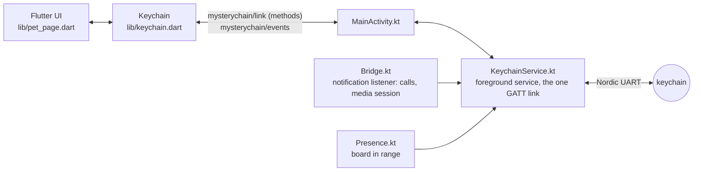

# Mobile app

Flutter companion app (Android). Connects to the keychain over BLE (Nordic UART service, device name `MysteryChain`), and keeps the link with the app closed.

- **Pairing** through Android's companion device dialog (once). After that the phone connects by itself whenever the keychain is in range, app open or not.
- Sets the keychain's clock on every connect.
- **Find keychain:** the keychain buzzes and blinks until its button is pressed, Stop is tapped, or 60 s pass.
- **Quick reactions:** ♥ (hearts on the keychain), On my way, Where are you?, Good night, Miss you. The list is `reactions` in `lib/main.dart`.
- Sends text: it scrolls in the pet's speech bubble and the motor buzzes twice.
- **Calls and music, app open or not:** while a call rings, the caller's name shows on the keychain and it buzzes until the call is answered or ends; when the playing track changes (Spotify, YouTube Music, any player with a media notification), title and artist show in the bubble. Needs Notification access.
- Activity list: what was sent, events from the keychain (`button N`, `shake N (x.xx g)`, `found`), connection changes.
- **Cat pet** (keychain running the cat scene): the pet's name in the header, today's steps and mood (the 0–100 stats stay on the keychain); **Feed** next to Find; game results in the activity list. The gear opens settings kept on the keychain: name, vibration, shake threshold, night window. Other scenes don't report stats, so these stay hidden.

- **Setup rows** under the header until each step is done: Nearby devices permission, Bluetooth on, pairing, Notification access, and on Xiaomi a link to Autostart and Battery saver.

Dark theme only for now. Design: [docs/mockups/app_screens.png](../../docs/mockups/app_screens.png), pet: [docs/mockups/app_pet_screens.png](../../docs/mockups/app_pet_screens.png).

Tested on a Xiaomi Redmi Note 12. iOS is not set up.

## How it works



- `KeychainService` holds the only Bluetooth connection to the board (the board takes one). It runs as a foreground service with a "Keychain connected" notification, reconnects in the background, sends `#time` on every connect and keeps the last `stats`/`settings` for when the app opens.
- `Bridge` (a notification listener, needs Notification access) reads ringing calls and the playing track and hands them to the service, which replays them on connect.
- Pairing goes through `CompanionDeviceManager`: no scanning in the app, the right address type for the board, and Android lets a paired companion app start the service from the background and wakes it when the board is in range (`Presence`).
- The service starts from the app, from the listener and from presence; Android restarts it if it's killed.
- Flutter only draws and sends (`lib/keychain.dart` is the state; `lib/protocol.dart` parses the board's lines). No Bluetooth plugin.

## Build and install

```bash
flutter pub get
flutter analyze && flutter test
flutter build apk --release       # build/app/outputs/flutter-apk/app-release.apk
adb install -r build/app/outputs/flutter-apk/app-release.apk
```

Version: `version:` in `pubspec.yaml` (name+code); raise the code for every APK you hand out.

Release builds are signed with the key named in `android/key.properties` (not in git):

```properties
storeFile=/home/<you>/.android/mysterychain-release.jks
storePassword=...
keyAlias=mysterychain
keyPassword=...
```

Keep the keystore and its password backed up: an update signed with another key doesn't install over the app (uninstall first, which drops pairing and Notification access). Without `key.properties` the release build falls back to the debug key.

## First start

1. Allow **Nearby devices** (and notifications, for the link's notification).
2. **Pair**: the keychain must be on and not connected to another phone. Pick it in the system dialog.
3. **Allow** Notification access for calls and music.
4. **Xiaomi/MIUI**: in the app info page that opens, turn on **Autostart** and set **Battery saver** to **No restrictions**; also lock the app in recents. Otherwise MIUI stops the link when the app is swiped away. If calls and music stop after an update, opening the app once makes Android bind the listener again.

## Protocol

Plain UTF-8 text over Nordic UART, one message per write (MTU 247). The phone writes to RX `6E400002-…` and listens to TX `6E400003-…` (notify). Plain text goes to the bubble; messages starting with `#` are commands (`#time`, `#find`, `#heart`, `#call`, `#music`, and for the cat `#feed`, `#stats`, `#set`). A notification may carry several lines; the app splits them. Full list: [watch protocol](../watch/README.md#protocol).
