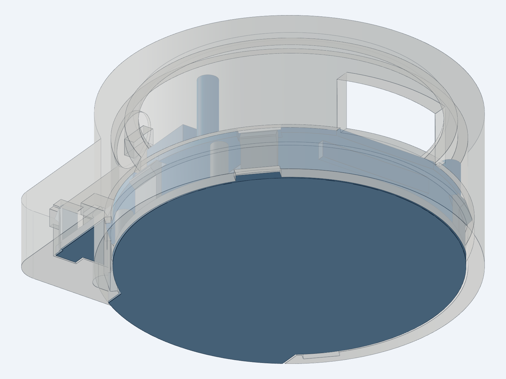
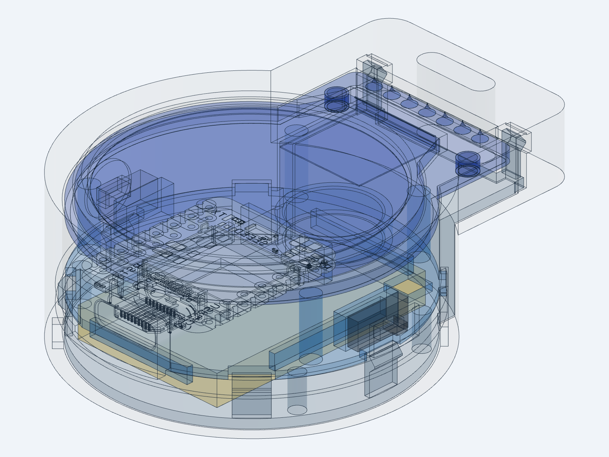

# Mechanical

Round 3D-printed case, Ø42.2 × 19.2 mm, with a keyring slot. Three printed parts that snap together, no screws. Everything assembles from the back.

**Status:** case v5 (display header removed, shallow lug), ready for the first test print.

| Front | Back | Internals (transparent) |
| --- | --- | --- |
|  |  |  |

All dimensions below come from [`pet_case.step.py`](pet_case.step.py) (build123d). Parameters are at the top of that file.

## Files

| Path | Content |
| --- | --- |
| `pet_case.step.py` | Parametric source (build123d) |
| `pet_case.step` | Assembly STEP: printed parts + electronics + keep-out zones. Import into Onshape or any CAD. |
| `print_parts.py` | Exports the print files |
| `print/` | `.3mf` and `.stl` per part, already in print orientation |
| `parts/` | Vendor STEP models: Seeed XIAO nRF52840 Sense, Teyleten GC9A01 (`_nopins` = same model with the 7-pin header removed; the case uses this one) |
| `archive/pet_case_v2.py`, `archive/pet_case_v4.py` | Earlier designs, kept for reference (v4 = header pins kept, 15.23 deep lug) |
| `renders/` | Images |

## Overall dimensions

| | |
| --- | --- |
| Body diameter | **Ø42.2** (inside Ø38.6, wall 1.8) |
| Body thickness | **19.19** |
| Total length (body + keyring lug) | **54.4** |
| Lug width / depth | 26.96 / 8.43 (stepped: its back face sits 10.76 in front of the body's back face) |
| Display window | Ø33.0 + 0.7 chamfer, offset 0.335 toward USB |
| Bezel | 1.2 |
| Printed parts weight (PETG, 100% infill) | ~13 g max |

**Coordinates:** origin at the display center, z = 0 back face, z = 19.19 front face. Looking at the display: **+Y up** (keyring lug and display tab), **−Y down** (USB-C), **+X right** (power switch), **−X left** (button).

## Layer stack (front to back)

| Depth from front (mm) | Thickness | Layer |
| --- | --- | --- |
| 0 – 1.20 | 1.20 | Bezel, Ø33 window |
| 1.20 – 1.50 | 0.30 | Glass gap (also absorbs the display tape) |
| 1.50 – 3.13 | 1.63 | LCD panel |
| 3.13 – 4.73 | 1.60 | Display PCB, sits on a step in the housing |
| 4.73 – 7.98 | 3.25 | Behind the display: **3.0 net** to the XIAO. The display's rear LDO is ≤ ~1.45. |
| 7.98 – 12.49 | 4.51 | XIAO: PCB, components and USB-C (4.21) + 0.3 |
| 12.49 – 13.49 | 1.00 | Midframe plate |
| 13.49 – 17.99 | 4.50 | Battery 4.0 + 0.5 swelling allowance |
| 17.99 – 19.19 | 1.20 | Back cover |

The lug region is 8.43 deep: the display's 7-pin header is removed, which leaves 2.5 behind the tab for the wire joints (pin stubs ≤ 1 + 30AWG wires bent flat). With the pins kept (v4) it was 15.23.

## Printed parts

**Front housing** (42.2 × 54.4 × 19.2)

- Body and keyring lug in one piece: keyring pull goes into the body, not into the PCB or the cover.
- Display seat: PCB step Ø38.6, LCD recess Ø36.0, clearance for the LCD neck/FPC bend and the header's front solder joints. The tab pocket is open to the back because the display inserts from the back.
- **USB-C pocket** 13 × 7, down to the receptacle face, so the plug overmold (USB-IF max 12.35 × 6.5) seats fully.
- **Power switch (+X):** 3.4 × 1.4 slot, with a 6.5 × 3.6 × 0.9 thumb recess outside; the lever sticks out ~0.7.
- **Button (−X):** 3.6 × 2.0 hole and a Ø6.4 finger dimple; the plunger sticks out ~0.3 from the dimple floor.
- **Keyring slot** 10 × 3, oval, through the lug. Bridge 2.4, web 1.2.
- Hook groove on the inner wall (R20.0, z = 4.0–6.2), plus 2 hook recesses just beyond the tab tip.
- Key channels at 45° and 135°: stop the midframe from rotating and make it fit one way only.
- Pry notch at 225° on the back edge, 5 mm wide.

**Midframe** (37.9 × 37.1 × 10.8)

- 1.0 plate, Ø38.2, 0.2 clearance to the wall, key tabs at 45°/135°.
- **Display clamp legs:** Ø2.4 at r = 17.6, at 60°/120°/205°/335°. They press on the display PCB edge; the LCD floats.
- **XIAO:** 8 × 8 tape pad with a 0.5 gap to the shield (for 0.5 mm double-sided tape), plus a 12 mm stop rib at the antenna end that takes the USB insertion force.
- **Motor cup:** Ø10.5 inner / Ø12 outer, 3.2 high, 2 mm wire notch toward USB.
- **Backer blocks** behind the switch and button take the press force.
- **Battery ribs** on the back: 0.8 thick, 2 high, at x = ±10.5 and y = ±15.5.
- Battery wire pass-through 3.5 × 3.5 (x = 10–13.5, y = 9–12.5); USB plug clearance on the −Y edge; notches where the cover hooks pass.

**Back cover** (39.4 × 47.5 × 16.9)

- Stepped: Ø38.2 disc + fill for the lug wall notch + tab back plate.
- **Perimeter hooks:** 4 at **0° / 180° / 225° / 315°**, 4 mm wide. 270° hits the USB plug, 240°/300° hit the battery corners.
- **Tab-tip hooks:** 2 at x = ±10, 2 mm wide, on tongues of the tab plate. They rise beside the display tab tip (0.3 clear, 0.15 while flexing), not behind it, so the shallow lug still fits a full-length arm.
- Hook arm 0.7 thick, ~3.7 free length, 0.4 radial catch, 45° retention ramp (the cover can be removed).
- **Posts:** Ø2 at r = 17.9, at 30°/150°/210°/330° (clear of battery corners). They push the midframe forward, which clamps the display onto its step.

## Component placement

| Component | Position | Held by |
| --- | --- | --- |
| Display module | Front center, tab toward +Y (lug) | Housing step (front) + midframe legs (back). No load on the wires. |
| XIAO | 3 mm behind the display, components facing back, USB-C on the −Y edge; x = 0, y = −18.2 … +4.3 | Tape pad + stop rib at the antenna end |
| Motor | Front of the midframe, x = 0, y = 11.8 | Cup + the motor's own adhesive |
| Power switch | +X wall, 10.2 deep from the front | Wall slot + backer block |
| Button | −X wall, same depth | Wall hole + backer block |
| Passives (R, D, C, BC337) | Beside the XIAO on +X: x = 9.5–14, y = −12 … −4.5, height ≤ ~4.3 | Soldered in free air, heat-shrink + Kapton. BC337 lying on its side. |
| Battery | Behind the midframe, long side along Y, 20 × 30 × 4 | Ribs + cover; 0.5 side and 0.5 swelling clearance |

## Clearances

| Where | Gap (mm) |
| --- | --- |
| Display PCB ↔ housing (radial) | 0.25 |
| Display tab ↔ pocket | 0.25 |
| Polarizer ↔ bezel | 0.30 |
| Display PCB ↔ XIAO | 3.00 net |
| XIAO components ↔ midframe | 0.30 |
| Midframe and cover disc ↔ wall | 0.20 |
| Battery (sides / thickness) | 0.5 / 0.5 |
| USB pocket ↔ plug overmold | 0.33 sides, 0.25 top/bottom |
| Switch and button holes | ~0.2–0.3 |

If the hooks are too tight or too loose, move the groove in 0.1 mm steps (`CATCH_Z0`, `GROOVE`).

## Assembly

1. **Solder everything first** (see [electronics bring-up](../electronics/bring-up.md)). Remove the display's 7-pin header first: pry the black plastic spacer off, cut the pins to ≤ 1 mm, solder the wires to the stubs and bend them flat along the PCB back toward the body (≤ 2.5 behind the PCB).
2. **Display:** from the back. Tab into the lug pocket first, then seat the PCB on the step.
3. **Switch and button:** into their wall holes from inside.
4. **Midframe:** XIAO taped to the pad (0.5 mm tape), motor in its cup. Insert with the key tabs in the 45°/135° channels; the backer blocks lock the switch and button.
5. **Battery:** between the ribs on the back, wire through the 3.5 mm pass-through.
6. **Back cover:** press the tab end first, then the disc. 4 perimeter + 2 tab hooks click in.

To open: lift at the 225° notch with a fingernail or a small screwdriver.

> The XIAO's reset button and LEDs face the midframe and can't be reached with the case closed. Opening the cover is needed for a bootloader double-reset. Charge status can be read from P0.17 and shown on screen.

## Printing

| Part | Face on the bed | Supports |
| --- | --- | --- |
| `front_housing` | Front face (clean window chamfer) | Probably none (USB and side holes are short bridges) |
| `midframe` | Battery ribs | **Yes**, touching the bed only |
| `back_cover` | Disc, hooks up | **Yes**, under the tab plate (it overhangs ~5–9 mm at 10.8 high) |

PETG (hook arms are 0.7 mm, PLA may snap), 0.4 mm nozzle, 0.12–0.16 mm layers, 3–4 walls, 30% infill. Open the 3MF in Bambu/Orca/Prusa/Cura; send the STL to a print service.

On the first print check: hook fit, display seating on its step, USB-C plug going all the way in.

## To measure (assumptions in the CAD)

| Item | CAD value | Source |
| --- | --- | --- |
| Display PCB diameter / thickness | Ø38.1 / 1.59 | Teyleten STEP, may vary by vendor |
| Display tab width / module length | 22.86 / 45.5 | STEP |
| Wire joints behind the tab pads | ≤ 2.5 | Assumed (header removed, stubs ≤ 1). `TAB_REAR` |
| Components behind the display | ≤ 1.45 (SOT-23 LDO) | Not measured |
| Battery | 20 × 30 × 4 incl. PCM | Name "402030"; measure when bought |
| Switch body | 1.5 × 7.2 × 3.5, lever 2.0 × 1.5 × 1.0, travel 1.5 | Assumed, switch desoldered from the LilyPad board |
| Button | 2.5 × 6 × 3.5 body + 1.8 plunger | Assumed 3 × 6 × 4.3 |
| Motor | Ø10 × 3 | Product name |

## Regenerate

Uses the [text-to-cad](https://github.com/earthtojake/text-to-cad) `cad` skill scripts and a Python env with build123d. Run from this folder:

```bash
C=~/.claude/plugins/cache/text-to-cad/cad/0.4.19/skills/cad/scripts
~/.venvs/cad/bin/python $C/gen pet_case.step.py --write    # STEP
~/.venvs/cad/bin/python print_parts.py                     # STL + 3MF
~/.venvs/cad/bin/python $C/inspect interfere pet_case.step --tolerance 0.0001 --format text
```

## Version history

| Version | Change |
| --- | --- |
| v1 | Three-part case: midframe, snap-on cover, battery safe zone |
| v2 | Real display STEP. Tab pocket opened to the back. USB pocket fixed so the plug seats fully. |
| v3 | Ear removed. Shallow stepped tab. Keyring slot made one piece with the body. |
| v4 | Battery 402030. Display–XIAO gap 3.0 mm. Hook angles 0/180/225/315. Hook notches in the midframe. |
| v5 | Display header removed (`gc9a01_teyleten_nopins.step`). Lug 15.23 → 8.43 deep. Tab-tip hooks moved beyond the tab tip. Cover wall fill flush with the inner wall. |
